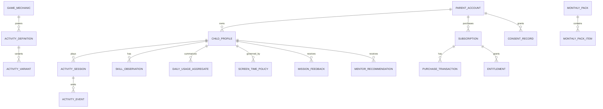

# LITTLE MINDS — PRODUCT BLUEPRINT & CURSOR DEVELOPMENT CONTRACT

> **Document status:** V2.7 product baseline / implementation contract — phone and tablet compatibility required in V1; approved screen-orientation policy (ADR-018); remaining implementation-level choices explicitly marked for Day 1  
> **Date:** 2026-10-27  
> **Primary language:** Turkish (tr-TR); canonical engineering identifiers in English  
> **Target:** iOS + Android Kids App on phones and tablets, embedded Mobile Parent Dashboard on phones and tablets, Web Parent Dashboard, Operations Admin Console, shared API, isolated staging/QA platform  
> **Age scope:** 24–71 months (2–5 years 11 months); 72+ months is a future expansion, not silently included.  
> **Release rule:** Kids App + Mobile Parent Dashboard + Web Parent Dashboard + subscription + parental play mentorship + screen-time controls + real-world missions + minimum viable Operations Admin Console + isolated staging/QA environment **ship together in V1.0**.

---

## 0. CURSOR / AI AGENT OPERATING CONTRACT — READ FIRST

This document is the **single product-scope source of truth**. Cursor, coding agents, contractors, and reviewers MUST use it before planning or changing implementation. Technical details may be refined via Architecture Decision Records (ADRs), but **no agent may silently remove, defer, or redefine a V1 P0 feature**.

### Mandatory agent workflow

1. **Read this entire file** and relevant existing source code before proposing changes. If context is limited, read Sections 0–5, 9–17, 20–23 and the section relevant to the task.
2. Identify `FEATURE-ID`, impacted user journey, API/data contracts, analytics events, privacy constraints, content/pedagogy rules, tests, and acceptance criteria.
3. Present a brief implementation plan and affected files for any nontrivial change. State assumptions; do not fabricate completed work.
4. Implement **vertical slices** (mobile + API + storage + dashboard + tests where relevant), not disconnected screens with mock metrics.
5. Keep all user-facing copy localized and pedagogically reviewed; never generate unreviewed content directly into the child experience.
6. Run type checks, tests, schema validation, lint, migration checks, and relevant device/web tests. Report what ran and what did not.
7. Update the traceability matrix and change log whenever behavior, data contracts, or content schemas change.
8. If a request conflicts with this contract, explicitly describe the conflict and request a product decision; do not silently overwrite the baseline.
9. **Every implementation task MUST have a Jira-assigned `LMP-N` ID (assigned on or after Day 1)**, a dedicated branch, an automated-test-backed GitHub Pull Request, and an explicit human review/merge gate. Follow Section 28. Do not claim a PR exists unless GitHub confirms its URL.
10. **Open/Closed Principle (OCP) is the default architecture rule**: extend via contracts, registries, adapters, versioned policies and configuration; avoid modifying stable core logic to add features. Follow Section 30 and document justified exceptions in ADRs.

### Non-negotiable rules

- **Child wellbeing over engagement**: do not optimize time-on-screen, streaks, infinite feeds, fear-of-missing-out, variable rewards, or manipulative retention.
- **No diagnostic claims**: play telemetry is **not** a measure of intelligence, developmental delay, autism, ADHD, neurodevelopmental status, or clinical milestones.
- **Caregiver relationship first**: digital play should frequently bridge to safe, adult-supported offline play.
- **Child safety by design**: no advertising, public profiles, child-to-child chat, user-generated content, external links in Kids Mode, unnecessary camera/microphone/location, or unreviewed third-party tracking SDKs.
- **Parental control**: only authenticated adult context may manage subscription, personal data, screen limits, consent, and dashboard. A simple arithmetic question alone is not strong authorization for sensitive account actions.
- **Privacy by default**: minimal data, purpose limitation, encryption in transit/at rest, retention limits, export/delete mechanisms, authorization tests, and parent-controlled consent.
- **Evidence-aware language**: distinguish measured in-app behavior, caregiver-reported observation, and pedagogical suggestion; never equate them.
- **Accessible, inclusive, culturally responsive**: multimodal instructions, reduced motion, audio/text alternatives for parents, adaptable difficulty, no gender stereotypes or single-family assumptions.
- **Offline-first Kids Mode**: core downloaded games and screen-time enforcement must work without internet; syncing and purchases have explicitly documented online dependencies.
- **One KPI definition**: backend produces canonical aggregate metrics for mobile and web. Clients do not implement divergent business formulas.
- **Content review gate**: generative AI may propose content and assets, but no generated item reaches children without automated checks **and human pedagogical/safety/localization approval**.

### Definition of Done (for each feature)

`Spec + accessible UX + localization + data migration (if needed) + API contract + security/consent handling + analytics semantics + unit/integration/e2e tests + error/offline states + documentation + LMP ticket + linked PR + CI evidence + reviewer sign-off`.

### Scope control

- `P0`: required at V1 launch; not negotiable without explicit product approval.
- `P1`: may ship at launch if capacity permits, otherwise a named later release.
- `P2`: research / post-launch.
- The previously discussed "Phase 1 then Phase 2 dashboard" plan is **superseded**. Both dashboards are P0.
- Do not equate **monthly content renewal** with deleting previous activities; age-relevant favorites can remain available.

---

## 1. PRODUCT VISION, POSITIONING, PERSONAS

**Product:** Little Minds — a subscription-based, developmentally appropriate play and parent-mentorship platform for ages 24–71 months.

**North star:** Enable caregivers to facilitate joyful, age-appropriate learning through brief digital invitations, shared real-world play, and understandable, non-diagnostic observations.

**Promise to caregivers:** "Know what to play, how to play together, what to notice, and what to try next" — not "your child's development score."

**Differentiators:**
1. Month-aware content with skill-sensitive difficulty, without rigid age pass/fail gates.
2. **Parent Play Mentor**: structured, context-sensitive caregiver coaching before/during/after activities.
3. Digital-to-physical **Real World Missions** with accessible household materials.
4. Parent-controlled daily usage budgets and healthy stopping points.
5. First-class mobile **and** web dashboards with traceable observations and practical recommendations.
6. Monthly themed content packs delivered through a reviewed content pipeline, not a monthly app binary release.

**Personas:**
- **Child 24–35 months**: short, concrete, sensory and cause-effect play; large touch targets, simple audio, flexible adult help.
- **Child 36–47 months**: classification, early number sense, language, pretend play, sequencing, increasing choice.
- **Child 48–59 months**: patterns, narrative, spatial reasoning, flexible problem solving, self-regulation support.
- **Child 60–71 months**: early literacy/numeracy foundations, multi-step reasoning, cooperative play, creative exploration.
- **Caregiver**: wants short, doable, affordable, safe activities and understandable guidance; may have little time/materials, multiple children, or different languages/access needs.
- **Content/pedagogy reviewer**: approves objectives, safety, developmental appropriateness, language and inclusive representations.
- **Operations/admin**: versions packs, monitors release quality, handles entitlements and support without unnecessary access to child records.

**Explicit non-goals:** diagnosis, therapy, standardized assessment, tutoring with performance pressure, replacing caregiver interaction, maximizing screen time, peer ranking, advertising, child social network.

---

## 2. GLOBAL PEDAGOGICAL FOUNDATION & VOCABULARY

The following are **design reference frameworks, not certifications or endorsements**. Curriculum decisions must be reviewed by a qualified early-childhood educator/development specialist and adapted for cultural and individual context.

| Framework / lens | Canonical term | Product interpretation |
|---|---|---|
| NAEYC | **Developmentally Appropriate Practice (DAP)** | Consider developmental commonalities, each child's individuality, and family/cultural context; strengths-based, play-based experiences. |
| UNICEF / LEGO Foundation | **Learning through Play** | Joyful, meaningful, actively engaging, iterative, socially interactive play; child agency and choice. |
| UNESCO / UNICEF ECCE | **Holistic Early Childhood Care and Education** | Cognitive, language, socio-emotional, physical, creative domains are interdependent; partner with families. |
| Vygotskian lens | **Scaffolding / Zone of Proximal Development (ZPD)** | Give graduated prompts and adult support; don't infer a validated ZPD from telemetry. |
| Bruner / guided play | **Guided Play** | Adult sets a meaningful invitation; child retains agency, exploration and choice. |
| Montessori-inspired practices | **Prepared Environment / Hands-on Exploration** | Accessible materials, real objects, repetition, independence; do not claim Montessori accreditation. |
| UDL | **Universal Design for Learning** | Multiple means of engagement, representation, and expression; adaptable input/audio/visual supports. |
| Formative assessment | **Observation & Documentation** | Record specific in-app behavior and optional caregiver notes, not global ability labels. |
| WHO under-5 guidance | **Healthy movement, sedentary behavior, sleep** | Avoid displacing physical play and rest; parent controls, short sessions, offline invitations. |
| Responsive caregiving | **Serve and Return / Responsive Interaction** | Encourage caregivers to notice, respond, extend language and follow the child's lead. |

**Terminology dictionary (UI + data):**
- `learning_domain`: broad domain (e.g., early numeracy, communication and language).
- `learning_goal`: concrete, observable **activity objective**, not developmental diagnosis.
- `play_schema`: exploratory pattern (e.g., transporting, positioning, connecting); optional educator-curated metadata, not a psychological profile.
- `skill_tag`: design tag for recommending content; **not** a clinical score.
- `scaffold_level`: type/amount of help offered within an activity.
- `guided_play`: adult-facilitated, child-led playful exploration.
- `open_ended_play`: no single correct outcome.
- `real_world_mission`: off-screen, safe, age-appropriate playful invitation.
- `caregiver_prompt`: suggested adult phrase/action/question.
- `observation`: concrete event or optional caregiver report, with provenance.
- `engagement_preference`: observed choice among offered games, not stable personality trait.
- `activity_progress`: completion/attempts on a particular game; **never** "brain development %".

**Forbidden UI claims:** "IQ", "developmental age", "normal/abnormal", "behind peers", "risk of autism", "your child is 85% developed", "proven to increase intelligence", "clinical screening". If a caregiver asks about developmental concerns, give neutral information and recommend consulting a qualified pediatric/developmental professional; do not analyze child gameplay as diagnosis.

**Age note:** 24–71 months is a content-navigation range, not a prescriptive checklist. Within-band variance is normal. Do not present month-specific goals as universal milestones. Where evidence is incomplete, label recommendations as product hypotheses.

**Evidence and reference URLs:**
- NAEYC DAP: https://www.naeyc.org/resources/position-statements/dap/contents
- UNICEF/LEGO Learning through Play: https://www.unicef.org/sites/default/files/2018-12/UNICEF-Lego-Foundation-Learning-through-Play.pdf
- UNESCO/UNICEF Global ECCE Report: https://www.unicef.org/reports/global-report-early-childhood-care-and-education-right-strong-foundation
- WHO under-5 movement/screen/sleep guidance: https://www.who.int/publications/i/item/9789241550536
- UNICEF Power of Play: https://data.unicef.org/resources/the-power-of-play/
- CDC Developmental Milestones (information, not a substitute for screening): https://www.cdc.gov/act-early/milestones/index.html

---

## 3. V1 FEATURE SET (CANONICAL)

| ID | Feature | Scope | Priority | Core acceptance |
|---|---|---|---|---|
| F-001 | Parent account, login, recovery, deletion | Mobile + web | P0 | Authenticated adult access; account deletion works |
| F-002 | Child profile and month-aware age | Mobile + web | P0 | Approximate age + reference date, correct month transitions |
| F-003 | Parent gate / role boundaries | Mobile | P0 | Child cannot open settings, purchases, reports |
| F-004 | Kids home / accessible navigation | Mobile | P0 | Age-appropriate choices, audio cues, no external navigation |
| F-005 | Six reusable mini-game mechanics | Mobile | P0 | Offline-capable, age/difficulty variants, event capture |
| F-006 | Age × skill recommendation engine | API + mobile | P0 | Deterministic, explainable, safe eligible pool |
| F-007 | Monthly reviewed content packs | CMS + API + mobile | P0 | Versioned release, rollback, downloaded offline |
| F-008 | Real World Missions | Mobile + parent | P0 | Screen-to-world bridge, no proof/photo requirement |
| F-009 | Parent Play Mentor | Mobile + web | **P0** | Before/during/after play coaching, adaptable scripts |
| F-010 | Parent-managed screen-time limits | Mobile + web | P0 | Offline enforcement, sync semantics, parent-only edits |
| F-011 | Break reminders and healthy endings | Mobile | P0 | No dark patterns or pressure to continue |
| F-012 | Activity event capture + local queue | Mobile + API | P0 | Versioned, idempotent, consent-aware sync |
| F-013 | Canonical KPI/insights aggregation | API | P0 | Traceable metrics, sample thresholds, provenance |
| F-014 | Mobile Parent Dashboard | Mobile | **P0** | Overview, trends, missions, mentorship, controls |
| F-015 | Web Parent Dashboard | Web | **P0** | Same KPI definitions and permissions as mobile |
| F-016 | Parent insights / coaching recommendations | API + dashboards | P0 | Rule-based, non-diagnostic, source and context |
| F-017 | Subscription & entitlement | Mobile + API + web | P0 | Store-verified, restore, renew, expire, refund |
| F-018 | Consent, privacy, export, deletion | All | P0 | Parent controls and documented retention |
| F-019 | Content Admin & review workflow | Web internal | P0 | Draft→review→approve→publish→rollback |
| F-020 | Accessibility and localization | All | P0 | tr-TR, en-US; age-appropriate and accessible |
| F-021 | Offline/online sync and conflict handling | Mobile + API | P0 | Correct on reconnect, duplicates prevented |
| F-022 | Reliability, observability, release controls | All | P0 | Crash/error monitoring without child profiling |
| F-023 | Multiple child profiles | Mobile + web | P1 | Strict profile isolation, separate limits/insights |
| F-024 | Advanced caregiver reflection journal | Dashboards | P1 | Optional notes, deletable, never diagnostic |
| F-025 | Rich AI-powered caregiver assistant | Parent only | P2 | Only after separate safety/privacy/pedagogy review |
| F-026 | Additional languages/regions | All | P1/P2 | Cultural review, not machine translation alone |
| F-031 | Multi-provider parent identity and safe account linking | Mobile + web + API | **P0** | GSM OTP first-class; Apple, Google, email OTP; stable parent ID, recovery and collision tests |
| F-032 | Progressive optional parent demographic profile | Mobile + web + API | **P0** | Non-blocking, skip-friendly, purpose-limited and editable; analytics opt-in where required |
| F-033 | Versioned privacy notice, consent and preference center | All + admin | **P0** | Notice acknowledgment distinct from consent; granular opt-in, withdrawal, audit, deletion |
| F-034 | Native phone and tablet adaptive experience | iOS + Android Kids App and embedded Parent Dashboard | **P0** | Same features on supported phones/tablets; adaptive layouts, usable touch targets, orientation/safe-area handling, device-class QA |

**Six V1 game engines:** shape matching, color sorting, animal/sound matching, counting, memory matching, object categorization. A near/far spatial-relation activity can be a **variant** of the matching/positioning interaction engine or a small additional mechanic, but its end-to-end demo is **P0** because it validates Real World Missions and mentorship.

---

## 4. PARENT PLAY MENTOR — FIRST-CLASS CORE FEATURE

### 4.1 Job to be done

A parent should be able to answer: **What should we play? Why is it appropriate? What materials do I need? What do I say? How can I help without taking over? What should I notice? How can I extend it off-screen?**

The mentor is **not** an autonomous therapist, medical advisor, developmental assessor, or replacement for professional care.

### 4.2 Mentor experience (P0)

1. **Today Together**: 1–3 suggested play invitations selected by age range, recent activities, preferences, accessibility, available time/materials and diversity. No guilt if skipped.
2. **Before Play**: learning intention in plain language, prep time, household materials, safety note, estimated screen time and offline time, short parent script.
3. **During Play**: optional `Observe → Wait → Respond → Extend` coaching prompts; never cover child interaction or force parent presence for every tap.
4. **After Play**: offline invitation, 1–2 open-ended questions, an easier variation, a harder variation, optional caregiver reflection.
5. **Parent Coaching Library**: short guides on following child's lead, open-ended questions, positive descriptive feedback, turn-taking, co-regulation, scaffolding, and playful repetition.
6. **Personalized Mentor Cards**: e.g. "Your child often chooses shape games. Try finding circles and squares in the kitchen together." Every card cites the **observed app behavior** that triggered it, if personalized.
7. **Accessibility/constraints**: no-purchase materials, small-space alternative, seated alternative, low-noise alternative, sensory-friendly alternative, culturally adaptable examples.
8. **Caregiver choice**: skip, save, repeat, mark tried, request different materials; never penalize.

### 4.3 Coaching language rules

**Preferred:** "You might try…", "Invite your child to…", "Wait a moment and see what they notice", "Describe what happened", "There is no single right answer".

**Avoid:** "Your child should be able to…", "Correct their mistake immediately", "You must complete 5 missions daily", "Your child is behind", "Keep playing to unlock development".

**Examples:**
- Observe: "What happens when you move the toy closer?"
- Wait: pause for child's response; avoid repeated prompting.
- Respond: "You moved the sock nearer to the bear!"
- Extend: "What if we put one toy on the other side of the room?"

### 4.4 Mentor content object

Each mentor card MUST specify:
`mentor_card_id, version, locale, title, age_min_months, age_max_months, domains[], goals[], interaction_style, estimated_prep_minutes, estimated_screen_minutes, estimated_offscreen_minutes, materials[], safety_constraints[], parent_script_before[], parent_prompts_during[], parent_prompts_after[], scaffold_down[], extend_up[], adaptations[], evidence_refs[], review_status, reviewer_id, reviewed_at`.

A caregiver-facing mentor card MUST explain **what is observed vs suggested**, and include a "not a developmental assessment" note where relevant.

### 4.5 Mentor recommendation policy

- Age suitability is a hard eligibility filter; skill tags are soft signals, not clinical indicators.
- Prefer material availability, low setup burden, content diversity, and off-screen play.
- Do not use engagement duration as a positive ranking objective.
- Every personalized suggestion includes `reason_code`, `evidence_window`, and `sample_size` or is labeled "general age-appropriate idea".
- Do not generate free-form personalized developmental advice from an LLM in V1. Rule-based templates with reviewed copy only.

---

## 5. SCREEN TIME & REAL-WORLD BRIDGE

### 5.1 Parent-controlled screen time (P0)

- Daily cap configurable by caregiver; proposed UI presets: 10, 15, 20, 30, 45, 60 minutes, with a configurable lower default (e.g. 20 minutes) **as a product hypothesis**, not medical guidance.
- A 30-minute cap is a **maximum**, not a target; dashboard never rewards consuming the full budget.
- Active child-mode foreground time counts: game, selection, in-app child menus. Parent dashboard does not count.
- Backgrounded, device-locked, or paused for off-screen mission does not count; use monotonic clock during active sessions, persist elapsed deltas, reconcile carefully across restarts.
- Parent may choose reminder interval and optional stricter per-session cap. Parent-only overrides require re-authentication for sensitive operations.
- At limit: finish/stop at a safe boundary, show calm ending, block new child activities; no "one more level" manipulation.
- Timezone/day boundary policy: store household IANA timezone, reset at local midnight with anti-tamper best effort, store UTC events, handle DST and travel explicitly.
- Offline: enforce last locally stored authenticated policy. A web change on an offline device is **pending**; show `last_synced_at` and status in dashboard. Do not promise instantaneous remote enforcement.
- Multiple devices: enforce local caps and sync aggregate usage; a truly strict shared cap across simultaneously offline devices is **not technically guaranteed**. Warn caregivers and document limitation.
- WHO guidance is an external health reference, not an instruction to maximize permitted screen time; consult current local pediatric guidance for family-specific advice.

### 5.2 Real World Mission pattern

`Digital Invitation (1–3 min) → Pause/Exit Screen → Caregiver-led Real-World Exploration (5–15 min, optional) → Optional Parent Reflection`.

**Canonical example:** near/far (spatial relationships)
- Screen: move a sock and a soft toy closer/farther; spoken labels "near"/"far".
- Off-screen: adult gathers **one sock and one soft toy** (prefer to a glass cup), places them near/far apart, invites child to describe or gesture.
- Mentor prompts: "Which one is closer?", "What changed?", "Can you put the toy farther away?".
- Adaptation: point instead of moving; seated version; low-vision tactile guidance with adult.
- Safety: no breakable glass, choking-size objects, cords, sharp or hot items; adult supervision.
- Feedback: `tried_together | tried_independently | tried_with_support | not_yet | skipped`, with `source=caregiver_report`. No photographic/video proof.

**Other V1 missions:** color hunt, big/small towels, count 3 large toys, round/square household objects, what-is-missing memory, soft-item sorting, pattern with large blocks, sound listening in a safe setting, pretend shopping with safe objects.

---

## 6. AGE-MONTH CONTENT MATRIX (24–71)

This is a **flexible content design matrix**, not a universal milestone checklist. Month-by-month novelty is achieved through theme, material, activity variants and scaffold changes, **not 48 separately coded game engines**.

| Months | Suggested play invitations | Interaction / support | Offline bridge |
|---|---|---|---|
| 24–29 | cause/effect, two-way matching, familiar sounds, basic spatial words | large tap targets, 1–2 options, adult co-play | move soft toys near/far, find familiar objects |
| 30–35 | shape/color sorting, big/small, count small sets, simple pretend play | tap and short drag, graduated hints | sort socks, count 1–3 safe large objects |
| 36–41 | classify, count sets up to ~5, simple patterns, language prompts | simple drag/drop, choice, short sequences | color hunt, 2-item patterns |
| 42–47 | memory, ordering, compare groups, story sequence | 2–3 step interactions, guided questions | sequence a routine, memory tray with large toys |
| 48–53 | patterns, spatial reasoning, narrative, early number sense | flexible tasks, multiple valid solutions | household patterns, pretend map |
| 54–59 | reasoning, number relationships, phonological play, creative storytelling | increasing choice and scaffold fade | rhyming games, object comparisons |
| 60–65 | sound awareness, flexible sorting, early symbol/number relations | multi-step with optional adult guidance | story retell, build and explain |
| 66–71 | emergent literacy/numeracy, planning, problem solving, collaborative play | more independent sequences, open-ended prompts | invent rules, co-create story, plan a build |

**Monthly pack rule:** For each age month `24..71`, CMS MUST resolve a published `MonthlyPack` containing a theme, 4–8 recommended digital activity variants (some repeat allowed), 4–8 off-screen missions, 2–4 mentor cards, and a balance of learning domains. These are **initial editorial targets**, not empirically validated dosage. The exact number is configurable. Existing favorites are not deleted automatically.

**Content dimensions:** age suitability, developmental domain, play type, motor demands, sensory demands, language load, adult support, duration, materials, risk class, accessibility, localization, cultural fit, difficulty/scaffold.

**Learning domains (canonical enum):**
`communication_language`, `early_literacy`, `early_numeracy`, `cognitive_reasoning`, `executive_function`, `social_emotional`, `physical_motor`, `sensory_exploration`, `creative_expression`, `approaches_to_learning`.

These are curricular categories; avoid treating domain-specific telemetry as comprehensive assessment of that domain.

---

## 7. THEMES, WORLD BUILDING & CONTENT GENERATION

### 7.1 Theme philosophy

**A theme is an emotional and narrative wrapper, not the pedagogy.** Learning goals remain stable while visual worlds, stories, props, music, and characters change. Themes should be globally comprehensible, locally adaptable, non-stereotyped, and calming rather than overstimulating.

**Starter theme library:** `cozy_home`, `garden`, `forest`, `ocean`, `farm`, `weather`, `neighborhood`, `space_imagination`, `seasons`, `shapes_and_patterns`, `music_and_movement`, `community_helpers`. Cultural/local variants must be reviewed; no exoticizing cultures or gender-coded jobs.

**Theme design tokens:** warm neutral backgrounds; restrained accent palette; rounded shapes; large interactive targets; high contrast; clear silhouettes; minimal simultaneous animation; consistent character scale; short musical cues; predictable navigation; audio controls; reduced-motion mode. Exact hex values, typography licenses, audio loudness and asset dimensions live in `/docs/design-system.md` and versioned design tokens, not arbitrary hardcoded widget values.

**Mascot/characters:** original IP; inclusive appearance and family settings; no copyrighted-character mimicry. Character feedback is descriptive ("You tried another way!") rather than ranking ("You're the smartest!").

### 7.2 Content generation pipeline (MANDATORY)

`Learning Goal → Age/Context Brief → Activity Mechanics Selection → Pedagogical Draft → Safety & Accessibility Check → Localized Copy → Asset Generation → Human Review → Automated Schema/Policy Validation → QA on Device → Staged Release → Analytics Review`.

- **Human-led learning goals** first; never prompt an image model to invent developmental standards.
- LLMs may **draft** scripts, variation ideas, localization candidates, structured activity JSON and parent prompts.
- Image/audio generation may **draft** assets; inspect for visual ambiguity, cultural bias, confusing affordances, brand/copyright resemblance, flashing effects and age-inappropriate content.
- Generated output MUST be treated as untrusted input; schema validate and manually approve before publishing.
- A human reviewer with appropriate early-childhood expertise must approve pedagogical content; a separate safety/QA check is recommended.
- Record `model_provider`, `model_version`, `prompt_version`, `generation_timestamp`, `asset_license/provenance`, `reviewer`, `approval_time`, `content_hash` for auditability.
- Never feed identifiable child-level activity histories or sensitive data into external generative services without a separate documented lawful basis, consent analysis, contracts and privacy review. **V1 avoids this entirely.**
- No live, unsupervised generative chat for children. Parent mentorship uses approved templates and deterministic recommendations.

### 7.3 Example generation brief (structured, not direct-to-publish)

```yaml
brief_id: near_far_32m_v1
locale: tr-TR
age_min_months: 30
age_max_months: 35
learning_domain: cognitive_reasoning
learning_goal: "Explore near/far spatial relationships through moving objects"
play_type: guided_play
interaction_mechanic: drag_position
max_screen_minutes: 3
estimated_offscreen_minutes: 7
materials: ["one sock", "one soft toy"]
safety: ["adult supervision", "no glass or choking hazards"]
caregiver_style: "warm, invitational, descriptive, non-evaluative"
required_outputs:
  - child_audio_script
  - parent_before_prompt
  - parent_during_prompts
  - parent_after_prompt
  - scaffold_down
  - extend_up
  - low_motor_demand_adaptation
  - asset_brief
prohibited_claims: ["diagnosis", "IQ", "normative milestone pass/fail"]
review_status: draft
```

### 7.4 Content acceptance rubric

Score each item (0=fail, 1=revise, 2=pass) on: learning-goal clarity, DAP fit, child agency, adult-child interaction, safety, accessibility, cultural/linguistic appropriateness, visual clarity, realistic household materials, off-screen transfer, evidence-aware claims. **Any safety or non-diagnostic-language failure blocks publication regardless of total score.**

### 7.5 Release and rollback

Draft → `pedagogy_review` → `safety_review` → `localization_review` → `approved` → `staged` → `published` → `archived`/`rolled_back`. Each version is immutable after publishing; changes create new versions. Mobile uses signed manifests/checksums and a previously validated offline pack when download fails.

---

## 8. USER EXPERIENCE & SCREEN INVENTORY

### 8.1 Kids Mobile

`Splash → Adult Setup / Child Mode → Age-appropriate Home → Activity → Calm Feedback → Real World Mission Invitation → Screen Pause/Exit`.

Screens: `K01 Welcome`, `K02 Kids Home`, `K03 Activity Player`, `K04 Pause / Break`, `K05 Real World Mission`, `K06 Daily Limit Reached`, `K07 Offline / Download State`, `K08 Audio / Accessibility Options` (age appropriate, sensitive changes gated).

### 8.2 Parent Mobile (within same app)

`Adult Gate → Login → Child Profile → Overview → Skills & Activity → Interests → Real World → Play Mentor → Screen-Time Settings → Subscription / Privacy`.

Screens: `M01 Adult Gate`, `M02 Auth`, `M03 Profile Setup`, `M04 Dashboard Overview`, `M05 Activity Trends`, `M06 Interest Patterns`, `M07 Real World Missions`, `M08 Play Mentor`, `M09 Mentor Card Detail`, `M10 Screen-Time Control`, `M11 Subscription`, `M12 Privacy / Data Export / Delete`, `M13 Sync Status`.

### 8.3 Parent Web

`Login → Profile Selection → Overview / Activity / Interests / Real World / Mentor / Controls / Billing Info / Privacy`.

Screens `W01..W10` mirror corresponding mobile parent features and use the **same backend metric definitions**. Web billing page can display subscription status and link to appropriate store management, but must not assume web can directly cancel a store subscription or bypass platform commerce rules.

### 8.4 Internal Content Admin

`A01 Content Library`, `A02 Age-Month Matrix`, `A03 Activity Editor`, `A04 Mentor Card Editor`, `A05 Mission Editor`, `A06 Asset Preview`, `A07 Review Queue`, `A08 Staged Release / Rollback`, `A09 Audit Trail`. Admin access must be separated from parent accounts.

---

## 9. DASHBOARD KPI CONTRACTS (CANONICAL)

All KPI calculations are server-defined, versioned and shared via API. Every metric should carry `period_start`, `period_end`, `timezone`, `data_freshness`, `sample_size`, `definition_version`, `source`, and `availability_status` where relevant.

| KPI ID | Name | Exact computation | Caveat |
|---|---|---|---|
| KPI-01 | Active child screen minutes | Sum of non-overlapping child-mode foreground intervals / 60 | Not device-wide screen time |
| KPI-02 | Activity starts | Count distinct `activity_started` sessions | May include incomplete sessions |
| KPI-03 | Completion rate | Completed eligible activity sessions / started eligible activity sessions | Not a developmental score |
| KPI-04 | First-attempt accuracy | Correct first attempts / eligible first attempts | Only tasks with objective answer |
| KPI-05 | Hint rate | Hint uses / eligible completed sessions | Compare same activity/difficulty |
| KPI-06 | Activity preference | Distribution of starts and active time among **offered** categories | Availability bias must be disclosed |
| KPI-07 | Within-task trend | Change across comparable windows for same activity variant and difficulty | Suppress with insufficient samples |
| KPI-08 | Variety | Count distinct categories with meaningful attempts | No streak incentives |
| KPI-09 | Off-screen missions tried | Count caregiver-marked `tried_*` mission instances | Self-reported, not verified |
| KPI-10 | Mentor usage | Cards opened/saved/marked tried (parent-only) | Do not treat as parenting quality |
| KPI-11 | Limit adherence | Days local screen cap reached/exceeded with sync status | Offline cross-device caveat |
| KPI-12 | Data freshness | Latest ingested event vs now | Show stale/pending state |

**Quality gates:** no trend without minimum comparable sample count (initial proposal: 5 eligible sessions in each comparison window; configurable), exclude invalid/duplicate events, show "not enough information" rather than zero or speculative interpretation. Never create global child scores or peer percentiles.

**Dashboard modules (all P0):** Overview; Activity & Skill-specific Performance; Interest/Preferences; Real World Missions; **Parent Play Mentor**; Screen-Time & Break Controls; Profile/Subscription/Privacy; Sync/Completeness.

**Insight template schema:** `insight_id, child_id, template_id, rule_version, metric_ids[], evidence_period, sample_size, evidence_summary, plain_language_text_key, action_mentor_card_id, severity=informational, generated_at, expires_at`. No medical severity flags or unsupported developmental inferences.

---

## 10. RECOMMENDATION ENGINE — DETERMINISTIC V1

1. **Eligibility filters:** age suitability, safety, locale availability, accessibility, parental restrictions, content publication status, downloaded/offline availability.
2. **Signals:** explicit caregiver preferences, age band, completed activity categories, child selections among shown options, replay preferences, novelty, diversity, recent repetition and real-world material availability. Individual first-attempt accuracy, hint rate and other performance-derived child scores MUST NOT be used for recommendation or punitive difficulty adjustment (ADR-017 / Section 38.5).
3. **Ranking:** explainable rules; age appropriateness is **not** a soft weight that can be overridden. Any score weights are adjustable hypotheses, not scientific developmental coefficients.
4. **Difficulty:** use 3 internal `scaffold_level`/difficulty bands (`explore`, `practice`, `extend`); parent choice and educator-reviewed, non-diagnostic rules determine variants. Do not automatically demote or score a child using first-attempt accuracy, hint rate, response latency or inferred frustration. Any future performance-driven adaptation requires an explicit new ADR and pedagogy/privacy approval.
5. **Cold start:** curated age-band defaults and parent choice; never infer skills without observations.
6. **Parent mentor:** prioritize short, low-material, offline-capable and varied invitations; allow parent overrides.
7. **Fairness:** don't equate slower motor response, speech differences, disability accommodations, device latency, or adult assistance with lower cognitive capacity.
8. **Transparency:** each recommendation returns `reason_code` and user-safe explanation.

Example `reason_code`: `AGE_BAND_STARTER`, `REPEAT_FOR_FAMILIARITY`, `NEW_DOMAIN_EXPLORATION`, `OPTIONAL_SCAFFOLD`, `CARE_GIVER_SELECTED`, `OFFSCREEN_EXTENSION`.

---

## 11. SUBSCRIPTION & ENTITLEMENT LIFECYCLE

**V1 commercial hypothesis:** free starter set + monthly/yearly Plus. Prices and trials are configurable by storefront/region; do not hardcode ₺149.99 or ₺1,199 as permanent commitments. No ads.

**Store authority:** iOS App Store purchase APIs + server notifications; Android Google Play Billing + Developer API/notifications. Backend verifies transactions, renewals, grace, billing retry, revocation, refund and restores. Client purchase success alone does not grant durable entitlement.

**Canonical field extensions and precedence:** Section 38.3; in particular `store_valid_until`, `offline_access_until`, `revoked_at` and signed offline grants.

**Canonical fields:** `store`, `product_id`, `store_original_transaction_id`, `purchase_token_hash` (when applicable), `status`, `current_period_start`, `current_period_end`, `grace_until`, `auto_renew_status`, `last_verified_at`, `entitlement_until`, `event_source`.

**State semantics:**
- `FREE`: starter content.
- `PURCHASE_PENDING`: payment flow unresolved.
- `ACTIVE`: verified paid entitlement.
- `GRACE_PERIOD`: store-verified grace; retain access per store policy.
- `BILLING_RETRY`: payment retry; access depends on authoritative entitlement state.
- `CANCELLED_RENEWAL`: auto-renew off; **access remains until paid entitlement end**.
- `EXPIRED`: paid access ended.
- `REVOKED`: refund/fraud/revocation event; reconcile immediately.

**Critical independence:** `child_age_month_changed` is a **content event**, not a billing event. If child turns 33 months on the 5th and subscription renews on the 18th, 33-month eligible content appears on the 5th if entitlement is active.

**Cross-platform:** a parent identity may exist across platforms, but store entitlements must be mapped with server verification and platform-policy review. No invented automatic transfer, cancellation, or price parity guarantee.

**Web:** parent dashboard is included in paid product experience; web may display status, manage profile/controls, and direct to correct platform for store billing management. Any future web checkout requires separate platform/legal review.

---

## 12. SYSTEM ARCHITECTURE & REPOSITORY

### 12.1 Stack

- `apps/mobile`: **Flutter + Flame**; Kids Mode and embedded Parent Dashboard; offline cache, accessibility, native billing bridges.
- `apps/parent-web`: **Next.js + TypeScript**; responsive parent reports, mentor and controls.
- `apps/content-admin`: Next.js internal editorial/admin tool (may share workspace/components with parent web but separated roles/routes).
- `services/api`: **NestJS + TypeScript**, modular monolith, REST/OpenAPI, versioned event ingestion.
- `packages/contracts`: OpenAPI/JSON Schema, generated TS and Dart clients, stable event schemas.
- `packages/learning-rules`: pure deterministic rules and tests.
- `packages/analytics-defs`: canonical KPI definitions and SQL specs.
- `content`: versioned activity definitions, mentor cards, missions, themes, localization, asset manifests.
- `infrastructure`: PostgreSQL, object storage/CDN, secrets, deployments, migration scripts.

**Auth:** self-hosted, modular `IdentityModule` within the NestJS modular monolith, designed for later extraction; mature security/OIDC libraries, stable `parent_id`, pluggable SMS OTP/Apple/Google/email adapters, secure sessions and account linking. External SMS delivery remains provider-based. The server verifies identity, authorization and child ownership on **every** child-scoped endpoint. Content admin is a distinct RBAC/MFA boundary. See Section 31.

**Storage:** PostgreSQL for metadata, permissions, transactions, events/aggregates; S3-compatible object storage for immutable content packs; secure on-device storage for minimal local events and downloaded assets.

**Hosting:** **local-first**: complete Docker Compose-backed local integration before buying services. Then isolated `staging` and `production` with GitHub Actions deployment. Managed hosting is an option, not a precondition. Backups, restore tests, secret rotation and audit logs required.

**API design:** `/v1/...` REST; OpenAPI-first, idempotency keys for event ingestion and transaction callbacks; cursor pagination, strict validation, stable error codes. Use UTC timestamps and explicit IANA timezone for reporting.

### 12.2 Repository layout — approved split (ADR-014)

**Two private GitHub repositories** under the planned Little Minds organization; client and backend have independent branches, PRs, permissions and deployments. They remain one product, one blueprint and one Jira `LMP` project.

```text
little-minds-backend/
├── src/modules/                 # NestJS modular monolith incl. IdentityModule
├── prisma/                      # DB schema, migrations and seed
├── infrastructure/              # Docker Compose, deployment, optional observability
├── contracts/                   # Authoritative OpenAPI/JSON Schema
├── content/                     # Versioned learning/mentor definitions and assets manifests
├── tests/
├── docs/adr/
├── AGENTS.md
└── .github/

little-minds-client/
├── apps/
│   ├── mobile/                  # Flutter + Flame
│   ├── parent-web/              # Next.js
│   └── content-admin/           # Next.js
├── packages/                    # TypeScript UI and generated API client
├── generated/                    # Dart/TypeScript clients generated from backend contracts
├── tests/
├── docs/adr/
├── AGENTS.md
└── .github/
```

Local checkout: `~/Development/LittleMinds/{little-minds-backend,little-minds-client}`. Cursor may open both repositories as a multi-root workspace. Backend owns and versions the API contract; client generates TypeScript and Dart bindings from a **pinned** backend OpenAPI artifact/commit. Contract checks protect compatibility; no shared runtime source directory or implicit cross-repo relative imports. Both repositories link to the canonical versioned blueprint; avoid divergent copies.

### 12.3 System modules

`IdentityModule`, `ChildProfileModule`, `ContentCatalogModule`, `LearningRecommendationModule`, `MentorModule`, `RealWorldMissionModule`, `ScreenTimePolicyModule`, `ActivityIngestionModule`, `AnalyticsModule`, `InsightModule`, `SubscriptionModule`, `ConsentPrivacyModule`, `AdminReviewModule`, `AuditModule`.

---

## 13. DATA MODEL — CANONICAL ENTITY CATALOG

All identifiers are UUID/ULID; timestamps UTC; soft-delete only where retention policy requires it; avoid direct child PII in event payloads. Fields below are **minimum conceptual contract**, not final SQL syntax. The normative field/relationship and lifecycle refinements in Section 38 supersede any narrower or conflicting shorthand in this catalog. Exact migration files are created during Jira implementation, not in this blueprint.

### 13.1 Identity, consent, profile

| Entity | Essential fields | Notes |
|---|---|---|
| `parent_accounts` | `id`, `auth_subject`, `locale`, `timezone`, `created_at`, `deleted_at` | Stable internal parent UUID; provider identities are separate; auth subject mapped securely |
| `parent_identities` | `id`, `parent_id`, `provider`, `provider_subject`, `verified_at`, `linked_at`, `unlinked_at` | Unique (`provider`, `provider_subject`); never auto-merge based on phone/email similarity |
| `parent_demographics` | `parent_id`, `age_band_optional`, `gender_optional`, `number_of_children_optional`, `updated_at`, `collection_notice_version` | Optional, editable, removable; no birthdate needed; prefer age band and self-description |
| `privacy_notice_acknowledgments` | `id`, `parent_id`, `notice_version`, `locale`, `presented_at`, `acknowledged_at`, `surface` | Evidence of notice presentation/acknowledgment, NOT a substitute for lawful basis or consent |
| `processing_preferences` | `id`, `parent_id`, `purpose`, `status`, `legal_basis`, `policy_version`, `changed_at`, `source` | Separate optional analytics/marketing/other consent; versioned and withdrawable |
| `child_profiles` | `id`, `parent_id`, `nickname_optional`, `age_months_at_reference`, `age_reference_date`, `preferred_locale`, `accessibility_preferences_json`, `created_at`, `deleted_at` | Avoid exact DOB unless justified; month estimate uncertainty supported |
| `consent_records` | `id`, `parent_id`, `child_id_optional`, `purpose`, `policy_version`, `status`, `recorded_at`, `revoked_at`, `source` | Separate purposes: essential service, optional analytics, optional parent notes, etc.; legal basis reviewed |
| `parent_preferences` | `parent_id`, `child_id`, `available_materials`, `time_budget`, `sensory_preferences`, `co_play_preference`, `updated_at` | Optional, minimization; not diagnostic |
| `devices` | `id`, `parent_id`, `child_id_optional`, `platform`, `last_seen_at`, `last_policy_version`, `last_synced_at` | Pseudonymous device identifier, rotation policy |

### 13.2 Curriculum/content

| Entity | Essential fields | Notes |
|---|---|---|
| `learning_domains` | `id`, `code`, `label_key` | Canonical enums |
| `learning_goals` | `id`, `domain_id`, `objective_key`, `evidence_refs`, `review_status` | Observable objective, no clinical milestones |
| `skill_tags` | `id`, `code`, `domain_id`, `description_key` | Recommendation taxonomy |
| `themes` | `id`, `code`, `palette_token_ref`, `narrative_key`, `status` | Theme separate from goal |
| `game_mechanics` | `id`, `code`, `engine_version`, `input_capabilities` | Reusable Flame mechanic |
| `activity_definitions` | `id`, `mechanic_id`, `learning_goal_id`, `skill_tags`, `min_age_months`, `max_age_months`, `safety_class`, `status` | Immutable published versions via variants/releases |
| `activity_variants` | `id`, `activity_id`, `version`, `difficulty`, `scaffold_level`, `theme_id`, `locale`, `configuration_json`, `asset_manifest_id`, `review_status` | Schema validated, no arbitrary executable remote code |
| `monthly_packs` | `id`, `age_month`, `locale`, `theme_id`, `version`, `published_at`, `status` | One or more approved releases; unique active per month/locale/channel |
| `monthly_pack_items` | `pack_id`, `item_type`, `item_id`, `priority`, `sequence`, `is_optional` | activity/mission/mentor refs |
| `asset_manifests` | `id`, `version`, `checksum`, `storage_key`, `size_bytes`, `license_provenance`, `status` | Signed/checksummed bundles |
| `localizations` | `entity_type`, `entity_id`, `locale`, `key`, `text`, `review_status` | Review before publish |
| `content_reviews` | `id`, `entity_type`, `entity_id`, `version`, `review_type`, `reviewer_id`, `decision`, `notes`, `created_at` | Pedagogy, safety, accessibility, localization |
| `generation_provenance` | `id`, `entity_type`, `entity_id`, `provider`, `model_version`, `prompt_version`, `generated_at`, `content_hash` | Generated content traceability |

### 13.3 Mentor and real-world play

| Entity | Essential fields | Notes |
|---|---|---|
| `mentor_cards` | `id`, `version`, `locale`, `age_range`, `goal_ids`, `materials`, `scripts`, `adaptations`, `safety_notes`, `review_status` | Published reviewed parent guidance |
| `real_world_missions` | `id`, `version`, `linked_activity_ids`, `age_range`, `goal_ids`, `materials`, `steps`, `safety_notes`, `adaptations`, `review_status` | No mandatory proof |
| `mentor_recommendations` | `id`, `child_id`, `mentor_card_id`, `reason_code`, `evidence_summary`, `created_at`, `expires_at` | Do not persist unnecessary granular history |
| `mission_feedback` | `id`, `child_id`, `mission_id`, `status`, `reported_by_parent_id`, `reported_at`, `optional_note_ref` | `caregiver_report` provenance |
| `parent_reflections` | `id`, `child_id`, `mission_id_optional`, `encrypted_text`, `created_at`, `deleted_at` | P1 optional; stronger privacy controls |

### 13.4 Play telemetry, skills, analytics

| Entity | Essential fields | Notes |
|---|---|---|
| `activity_sessions` | `id`, `child_id`, `activity_variant_id`, `started_at`, `ended_at`, `duration_seconds`, `completion_status`, `device_id`, `schema_version` | Duration bounds validated |
| `activity_events` | `event_id`, `session_id`, `event_type`, `occurred_at`, `received_at`, `payload_json`, `schema_version`, `consent_scope` | Idempotent, allowlisted payload |
| `skill_observations` | `id`, `child_id`, `skill_tag_id`, `activity_variant_id`, `difficulty`, `observation_type`, `value`, `observed_at`, `source` | Not developmental diagnosis |
| `skill_state` | `child_id`, `skill_tag_id`, `scaffold_level`, `evidence_count`, `rule_version`, `updated_at` | Recomputable derived state |
| `daily_usage_aggregates` | `child_id`, `local_date`, `timezone`, `active_seconds`, `data_complete`, `computed_at`, `definition_version` | Time intervals deduplicated |
| `activity_aggregates` | `child_id`, `activity_id`, `window_start`, `window_end`, `attempts`, `completed`, `first_attempt_eligible`, `first_attempt_correct`, `hints`, `definition_version` | Canonical KPIs |
| `insights` | `id`, `child_id`, `template_id`, `rule_version`, `evidence_window`, `sample_size`, `metric_refs`, `mentor_card_id`, `created_at`, `expires_at` | Reviewed templates, explainable |

### 13.5 Screen time, subscription, operations

| Entity | Essential fields | Notes |
|---|---|---|
| `screen_time_policies` | `id`, `child_id`, `daily_cap_seconds`, `session_cap_seconds_optional`, `break_interval_seconds`, `timezone`, `version`, `updated_by_parent_id`, `updated_at` | Parent-owned, versioned |
| `screen_time_intervals` | `id`, `child_id`, `device_id`, `started_at`, `ended_at`, `active_seconds`, `sync_status` | No overlapping double-counting |
| `subscriptions` | `id`, `parent_id`, `store`, `product_id`, `status`, `current_period_end`, `last_verified_at`, `auto_renew_status` | Store is authoritative |
| `purchase_transactions` | `id`, `subscription_id`, `store_event_id`, `original_transaction_ref`, `event_type`, `verified_at`, `payload_hash` | Encrypted sensitive tokens; idempotent |
| `entitlements` | `id`, `parent_id`, `feature_key`, `valid_from`, `valid_until`, `source_subscription_id`, `status` | Access decisions use this |
| `sync_cursors` | `device_id`, `child_id`, `last_uploaded_event_id`, `last_downloaded_policy_version`, `last_sync_at` | Conflict policy |
| `audit_logs` | `id`, `actor_id`, `actor_role`, `action`, `resource_type`, `resource_id`, `created_at`, `metadata_redacted` | No raw child events/secrets in logs |
| `deletion_requests` | `id`, `parent_id`, `scope`, `requested_at`, `status`, `completed_at` | Auditable deletion workflow |

### 13.6 Entity relationships



**Canonical relational constraints, types and indexes:** Section 38.1–38.2.

**Database invariants:** ownership FK + authorization; unique event IDs; immutable content version refs; no cross-child joins without authorized parent; no orphan purchase transaction; published packs reference approved content only; all aggregate values derivable from valid source events.

---

## 14. EVENT CONTRACT & SYNC

**Canonical event envelope, ownership, sync, clock-trust and replay rules:** Section 38.4. Earlier examples in this section are illustrative and may omit required fields; they are not a complete production event schema.

### 14.1 Allowlisted event types

`activity_started`, `activity_attempted`, `activity_hint_used`, `activity_completed`, `activity_abandoned`, `child_mode_foreground_started`, `child_mode_foreground_ended`, `real_world_mission_offered`, `real_world_mission_opened`, `mission_feedback_submitted` (parent), `mentor_card_opened` (parent), `screen_limit_reached`, `content_pack_downloaded`.

**No raw touch coordinates, microphone recordings, child photos, contact lists, precise location, advertising IDs, or persistent behavioral fingerprinting.**

### 14.2 Example event

```json
{
  "event_id": "018f0000-0000-7000-8000-000000000001",
  "schema_version": 1,
  "event_type": "activity_completed",
  "session_id": "018f0000-0000-7000-8000-000000000002",
  "activity_variant_id": "shape_match_forest_l2_v3",
  "occurred_at": "2026-10-24T08:00:00Z",
  "payload": {
    "duration_seconds": 84,
    "eligible_first_attempts": 6,
    "correct_first_attempts": 5,
    "hints_used": 1,
    "completion_status": "completed"
  }
}
```

The example IDs/timestamps are illustrative. `child_id` is derived from the authenticated, authorized session or securely scoped upload context; do not trust arbitrary client-supplied ownership.

### 14.3 Sync behavior

- Offline queue is encrypted where supported, size-limited and retained only as long as needed.
- Event upload uses idempotent IDs and bounded batches; duplicates are no-ops.
- Server timestamps receipt; event time is validated against plausibility bounds; clock tampering flags data quality rather than producing false precision.
- Policy changes use monotonically increasing version; last authorized server policy wins when connected; local enforcement continues offline.
- Published content manifest is immutable and checksum verified; atomic switch after complete download.
- Deletions/consent withdrawals propagate to all relevant stores and queued uploads; no silent re-upload after withdrawal.
- Dashboard shows `sync_pending`, `last_synced_at`, and incomplete periods; never present partial data as complete.

---

## 15. API CONTRACT — MINIMUM ENDPOINTS

All child-scoped endpoints require verified parent ownership or tightly scoped authenticated device credentials. Content-only endpoints may use authenticated app/device access without exposing child data.

```text
POST   /v1/parents/register
GET    /v1/parents/me
DELETE /v1/parents/me
GET    /v1/children
POST   /v1/children
GET    /v1/children/{childId}
PATCH  /v1/children/{childId}
DELETE /v1/children/{childId}
GET    /v1/children/{childId}/recommendations
GET    /v1/children/{childId}/mentor/today
GET    /v1/mentor/cards/{mentorCardId}
GET    /v1/children/{childId}/missions
POST   /v1/children/{childId}/missions/{missionId}/feedback
GET    /v1/children/{childId}/screen-time-policy
PUT    /v1/children/{childId}/screen-time-policy
POST   /v1/events/batch
GET    /v1/children/{childId}/dashboard/overview
GET    /v1/children/{childId}/dashboard/activities
GET    /v1/children/{childId}/dashboard/preferences
GET    /v1/children/{childId}/dashboard/real-world
GET    /v1/children/{childId}/dashboard/insights
GET    /v1/content/packs?ageMonth=32&locale=tr-TR
GET    /v1/content/manifests/{manifestId}
GET    /v1/subscriptions/entitlements
POST   /v1/subscriptions/verify-purchase
POST   /v1/subscriptions/restore
POST   /v1/webhooks/apple
POST   /v1/webhooks/google
GET    /v1/privacy/export
POST   /v1/privacy/deletion-requests
```

Auth provider endpoints may replace `register`; webhook routes must verify source signatures/authentication, never rely on a publicly supplied status. Admin APIs live in `/v1/admin/*` with distinct RBAC and audit. `PUT screen-time-policy` requires optimistic version control and verified adult session. Use OpenAPI schemas and generated Dart/TS clients.

---

## 16. PRIVACY, SECURITY, LEGAL & ETHICAL GUARDRAILS

**Markets:** initial Turkish and English localization; market launch geography is a separate decision. Before release, obtain jurisdiction-specific review for Turkish KVKK, applicable GDPR/UK GDPR, US COPPA where applicable, Apple Kids Category and Google Play Families policies. **This document is not legal advice or proof of compliance.**

**Privacy-by-design requirements:**
- Adult identity and child profile segregated; minimal child attributes; nickname optional.
- No child email, real name requirement, DOB requirement, photo, location or microphone in V1.
- Purpose-specific data inventory and lawful-basis/consent mapping; essential service vs optional data distinguished.
- Third-party SDK allowlist and data processing agreements; no ad SDKs or behavioral marketing.
- TLS, encryption at rest, secrets management, key rotation, least privilege, RLS/DB-level protections where suitable, server ownership checks.
- Retention schedule to be approved **before launch**: e.g. raw telemetry shorter than aggregates, billing/audit according to legal obligations; do not hardcode arbitrary legal periods.
- Parent can access, correct, export and request deletion; account deletion handles local and server copies, backups and legal exceptions transparently.
- Parent-only dashboard with secure session expiry, logout and multi-device revoke.
- No cross-child comparisons, predictive mental-health/developmental profiling or automated consequential decisions.
- Content admin cannot casually inspect identifiable child activity; production support access must be scoped and audited.
- Parent coaching recommendations are educational ideas, not clinical instructions.
- Document incident response, security testing, dependency updates, privacy impact assessment and child-rights review.

**Screen time and wellbeing:** a product daily cap does not replace broader family/device screen-time settings. Parent can choose shorter limits; avoid default claims that 30 minutes is a universally optimal duration.

---

## 17. QUALITY, TESTING & RELEASE GATES

### Required automated tests

- **Phone/tablet compatibility (F-034):** automated layout/golden tests at representative compact phone, large phone, and tablet viewports on iOS/Android; verify safe areas, rotation where supported, touch targets, text scaling, split-screen/resizable window where supported, Kids Mode and embedded Parent Dashboard; no clipped/overlapping controls or missing P0 features.

- Unit: age-month transitions incl. leap dates, timezones, recommendation eligibility, difficulty/scaffold rules, screen-time budget calculations, insight templates, KPI formulas.
- Contract: OpenAPI generated Dart/TS clients, event schema versions, backward compatibility.
- Integration: parent ownership, consent, offline queue dedupe, content approval, entitlement webhooks, renewals/refunds, deletion.
- E2E: child plays offline → sync → same values on mobile/web; parent changes limit on web → connected mobile updates; offline pending status accurate.
- Accessibility: screen reader parent UI, touch target size, reduced motion, visual contrast, sound-off support, motor alternatives.
- Content: unsafe materials, missing review, unlocalized strings, prohibited claims, missing safety notes, wrong age range, broken assets, copyright provenance.
- Security: IDOR/cross-account access, JWT validation, admin role isolation, webhook replay, SQL injection, rate limiting, session expiry.
- Resilience: device crash mid-session, time-zone change, clock skew, repeated sync, corrupted content download, no internet, double purchases.

### Launch acceptance journeys

1. Parent signs up, creates age-32-month child, sets 30-min cap; both dashboards show policy.
2. Child opens near/far game, plays ~2 minutes, gets calm real-world invitation; adult sees mentor script.
3. Parent marks sock + soft toy mission "tried together"; dashboards show **caregiver-reported** status.
4. Event ingestion computes activity-specific KPIs; mobile and web match and show data freshness.
5. Recommendation changes only after sufficient comparable evidence, not one error; no diagnostic language.
6. Child ages into next month and receives appropriate reviewed pack independent of billing renewal.
7. Store purchase, renewal, cancel-renewal, refund/revocation, restore, offline entitlement behavior tested.
8. Screen cap works offline; web policy changes are shown as pending until device sync.
9. Parent exports/deletes child data; revoked consent prevents subsequent re-upload.
10. Content admin cannot publish an unreviewed AI-generated activity; rollback restores previous approved manifest.

**No release** if any P0 journey fails, serious child-safety/privacy issue is unresolved, unreviewed content is accessible, or dashboards silently display fabricated metrics.

---

## 18. IMPLEMENTATION ROADMAP & EPICS

**Planning assumption:** one experienced developer, ~20–25 hours/week, part-time support for pedagogy/art/QA. Full scope including both dashboards, backend, billing, content admin, mentor and safety may exceed 20 weeks. Treat schedule as a **planning hypothesis** with scope-preserving re-estimation, not a promised launch date.

| Epic | IDs | Must deliver | Priority |
|---|---|---|---|
| E01 Foundation | F-020, F-022 | Two-repo bootstrap, CI/CD, OpenAPI, localization, observability | P0 |
| E02 Identity & Profiles | F-001..003 | Adult auth, child age, role boundaries | P0 |
| E03 Kids Game Engine | F-004..005 | 6 engines + near/far vertical slice | P0 |
| E04 Learning & Content | F-006..007 | Age/skill rules, packs, offline assets | P0 |
| E05 Real World | F-008 | Missions, pause/exit, parent feedback | P0 |
| E06 **Parent Play Mentor** | **F-009** | Mentor scripts, library, Today Together, recommendations | **P0** |
| E07 Screen Time | F-010..011 | Parent policies, enforcement, sync, calm endings | P0 |
| E08 Data & Insights | F-012..013, F-016 | Events, aggregates, evidence-aware insights | P0 |
| E09 Parent Mobile | F-014 | All dashboard tabs incl. Mentor | P0 |
| E10 Parent Web | F-015 | Same KPIs/controls, responsive, secure | P0 |
| E11 Billing | F-017 | Apple/Google entitlements and lifecycle | P0 |
| E12 Content Admin | F-019 | Editorial approvals, releases, rollback | P0 |
| E13 Trust & Release | F-018, F-021..022 | Privacy, sync, accessibility, security, launch | P0 |

### Vertical slice sequence (never postpone dashboard)

- **Slice A / Foundation:** auth + age-32-month profile + mobile/web parent shell + API + DB migrations.
- **Slice B / Core promise:** near/far digital play + telemetry + daily cap + Real World Mission + **mentor card** + one canonical dashboard KPI on both clients.
- **Slice C / Learning:** six game engines, age/skill recommendations, 24–71 month content catalog, review pipeline.
- **Slice D / Productization:** full dashboard, mentor recommendations, subscriptions, offline/sync, privacy workflows.
- **Slice E / Launch:** parent/child usability, pedagogy sign-off, security, stores, analytics validation.

### Illustrative engineering work candidates — NOT an approved Jira backlog (Day 1 review required)

| Task | Epic | Acceptance |
|---|---|---|
| LM-001 | E01 | Repository, CI, environments and generated API clients build |
| LM-002 | E02 | Parent signs in and cannot access another parent's child |
| LM-003 | E02 | Age-month calculation correct on boundaries; no exact DOB required |
| LM-004 | E03 | Near/far game runs offline with age-specific content |
| LM-005 | E05 | Near/far leads to safe sock + soft toy mission; skip allowed |
| LM-006 | E06 | Mentor card shows why/how/what-to-say/safety/adaptations |
| LM-007 | E07 | Parent sets 30-min cap; mobile enforces locally and shows sync state |
| LM-008 | E08 | Event ingest is idempotent; dashboard KPI computed server-side |
| LM-009 | E09 | Mobile dashboard shows actual session and mission status |
| LM-010 | E10 | Web dashboard shows same session and mission status |
| LM-011 | E04 | Rule engine filters age-ineligible content and handles cold start |
| LM-012 | E03 | Six reusable mechanics support data-driven variants |
| LM-013 | E04 | Monthly pack published for every supported age month and locale |
| LM-014 | E12 | AI-drafted content blocked until human reviews approve |
| LM-015 | E06 | Today Together suggests varied, low-material off-screen play |
| LM-016 | E08 | Insight uses adequate samples, evidence and non-diagnostic copy |
| LM-017 | E11 | Purchases, renewals, refunds, restore, entitlement expiry pass |
| LM-018 | E13 | Privacy export/deletion and consent revocation pass |
| LM-019 | E13 | Offline sync, duplicate events, clock skew and time cap pass |
| LM-020 | E13 | Accessibility, locale, safety, child usability sign-off complete |

### Dependency order

`Contracts/Identity → Game Event Contract → Analytics → Both Dashboards` and `Learning Goals → Content Schema → Review Workflow → Published Packs → Recommendation Engine` and `Store Purchase → Verification → Entitlements → Paid Content Access`.

**Do not create a dashboard that displays static example data as live data.** Demo fixtures must be explicitly flagged and excluded from production.

---

## 19. ANALYTICS FOR PRODUCT HEALTH (SEPARATE FROM CHILD REPORTING)

Operational metrics: crash-free sessions, asset download success, API latency, sync backlog, billing error rate, content review turnaround, failed authorization attempts, parent dashboard load time, mentor-card usefulness feedback. Aggregate privacy-preserving measures of product adoption may be collected only under reviewed purposes/consent. **Do not optimize child screen time as growth KPI.** Product success is caregiver trust, successful offline transitions, understandable coaching, reliability, safe engagement, and repeat voluntary value.

---

## 20. OPEN DECISIONS / ADR QUEUE

These are **not permission to omit P0 features**; they are explicit choices to resolve before implementation or launch.

1. `ADR-001`: Exact initial launch markets and legal requirements.
2. `ADR-002`: **Resolved architecture direction:** self-hosted NestJS `IdentityModule` with extraction-ready boundaries, provider adapters and privacy controls; implementation/security design and deletion UX remain to be specified (Section 31).
3. `ADR-003`: Flutter state management, Flame integration, persistence/encryption.
4. `ADR-004`: PostgreSQL hosting, event retention and aggregation job scheduling.
5. `ADR-005`: Screen-time cross-device semantics, device clock skew and policy synchronization.
6. `ADR-006`: Billing product IDs, prices, trials, entitlements and web management UX.
7. `ADR-007`: Review staffing, qualification, content provenance, copyright policy.
8. `ADR-008`: First launch locales and culturally reviewed content inventory.
9. `ADR-009`: Child age uncertainty model and parent correction UX.
10. `ADR-010`: Parent mentor guidance style, accessibility adaptations, evidence review.
11. `ADR-011`: Final visual design tokens, mascots, licensed fonts and audio system.
12. `ADR-012`: Retention schedule, lawful bases, parental permissions and DPIA/child-rights review.
13. `ADR-013`: **Approved** cost-aware, pluggable observability; core logging always active; optional exporters and vendors gated (Section 31). Existing `ADR-004` remains reserved for PostgreSQL hosting.
14. `ADR-014`: **Approved** separate client and backend private GitHub repositories; one Jira project and versioned API contracts (Section 32). Existing `ADR-005` remains reserved for screen-time synchronization.
15. `ADR-018`: **Product Owner Approved / Accepted** V1 screen-orientation policy by surface; phone and tablet Day-1 mandatory (F-034); state preserved across orientation transitions; QA-UI-001 covers relevant orientations (Section 40).

---

## 21. PRODUCT TRACEABILITY MATRIX

Every P0 feature must map to at least one entity/contract, screen and test. Cursor should extend this table as implementation evolves.

| Feature | Key data | Screens | Mandatory test |
|---|---|---|---|
| F-002 Child age | `child_profiles`, `monthly_packs` | M03, W profile | Month rollover, age eligibility |
| F-005 Games | `activity_variants`, `activity_sessions` | K03 | Offline mechanics + event schema |
| F-006 Recommendations | `skill_state`, `skill_observations` | K02, M08 | Age hard filter + cold start |
| F-007 Monthly packs | `monthly_packs`, `content_reviews` | K02, A02 | Only approved content publishable |
| F-008 Missions | `real_world_missions`, `mission_feedback` | K05, M07, W Real World | Safety, optional feedback |
| **F-009 Mentor** | **`mentor_cards`, `mentor_recommendations`** | **M08/M09, W Mentor, K05** | **Before/during/after, provenance, no diagnostic copy** |
| F-010 Screen limits | `screen_time_policies`, `screen_time_intervals` | M10, W Controls, K06 | Offline enforcement and sync pending |
| F-013 KPI aggregation | `activity_aggregates`, `insights` | M04/M05, W Overview | Exact metric parity, sample gate |
| F-014 Mobile dashboard | canonical API | M04–M13 | Child ownership, real data |
| F-015 Web dashboard | canonical API | W01–W10 | Same KPI definitions as mobile |
| F-017 Subscription | `subscriptions`, `entitlements` | M11, W Billing | Verified lifecycle, refund |
| F-018 Privacy | `consent_records`, `deletion_requests` | M12, W Privacy | Export, delete, no re-upload |
| F-019 CMS | `content_reviews`, `generation_provenance` | A01–A09 | Human gate and rollback |

---

## 22. EXAMPLE FULL PLAY EXPERIENCE — 32 MONTHS

**Context:** caregiver entered approximate 32 months; 30-minute daily cap; child has not played near/far yet.

1. Dashboard Today Together: "Try near and far with two soft objects" (general age-suitable recommendation, no inferred ability claim).
2. Parent sees 2-minute setup, one sock + one soft toy, safety note, and simple prompts.
3. Kids Mode offers a calm 1–2-minute drag-position activity with spoken "near"/"far" labels and large targets.
4. Local app records activity duration, attempts and hint use; no raw touch path.
5. App offers real-world mission and pauses screen timer when child leaves active child mode.
6. Caregiver and child move objects, observe differences, use open-ended language.
7. Later, caregiver may mark `tried_together` or skip; no mandatory proof.
8. API syncs valid events. Mobile and web dashboards show screen time, activity completion and **self-reported** mission status.
9. Mentor offers a related variation ("Can you move the toy farther while seated?") without implying developmental diagnosis.
10. Next recommendation balances repetition with novelty, respects age, access needs and screen limit.

**Pass condition:** the same child profile, data provenance, usage totals, mentorship content and screen policy are coherent across mobile, web and offline/online transitions.

---

## 23. CURSOR PROMPT TEMPLATE FOR EACH IMPLEMENTATION TASK

Use the following as a reusable instruction in Cursor:

```text
You are implementing Little Minds. First read LITTLE_MINDS_PRODUCT_BLUEPRINT.md
in full, especially Section 0 and the relevant feature sections.

Task: <LMP-N + FEATURE-ID + specific objective>

Before coding:
1. List relevant acceptance criteria, data entities, API contracts, screens,
   analytics events, pedagogy/child-safety/privacy constraints.
2. Identify existing code and dependencies. State a concise plan.
3. Do not defer any P0 scope, invent development claims, or add unreviewed
   generative child content.

Implement an end-to-end vertical slice with tests, localization, offline/error
states, permission checks and documentation. Use canonical KPI definitions.
Do not display mocked metrics as real production data.

After coding:
- Report changed files and architectural decisions.
- Run and report tests/typecheck/lint/build where possible.
- List remaining risks or blockers honestly.
- Update traceability matrix and changelog if contracts changed.
- Create/update a feature/LMP-N-* branch; commit with LMP-N in the message.
- Push the branch and open a GitHub PR with title `LMP-N: <summary>`.
- Fill `.github/pull_request_template.md` with test cases and real evidence.
- Never self-approve or merge; report the actual PR URL and checks status.
- If GitHub access is unavailable, stop at a locally tested branch and clearly
  report the blocker; do not invent a PR URL or claim task completion.
```

**Recommended `AGENTS.md` content:**

```markdown
# Little Minds Agent Instructions
Read `LITTLE_MINDS_PRODUCT_BLUEPRINT.md` before every nontrivial task.
Its Section 0 is mandatory. The full blueprint defines P0 launch scope,
child safety, pedagogy, data contracts, analytics and release gates.
Section 28 mandates one LMP-N ticket, branch and test-evidenced PR per task.
Do not silently defer Parent Play Mentor, mobile/web Parent Dashboard,
Real World Missions, subscriptions or screen-time controls.
```

---

## 25. OPERATIONS ADMIN CONSOLE — V1 P0 CONTRACT

> **Scope decision (2026-10-24):** `apps/content-admin` is upgraded from an editorial CMS into **Little Minds Operations Console**. It remains an internal-only, role-protected web app. A production release without its P0 capabilities is incomplete.

### 25.1 Admin domains and launch requirements

| Admin domain | Required V1 operations | Guardrails |
|---|---|---|
| Content Catalog | CRUD draft activities, age-month packs, skill tags, localization, mentor scripts and real-world missions; preview by age/difficulty | No publish without pedagogical + safety approval |
| Theme & Asset Studio | Manage themes, visual/audio assets, manifest versions, licenses, locale coverage and content-generation provenance | AI-generated assets remain drafts until human review; no live generation into Kids Mode |
| Content Release | Stage, diff, approve, schedule, publish, pause and roll back signed/versioned manifests | Immutable release history; rollback to last approved content; compatible client versions |
| App Configuration | Screen-time defaults/bounds, session breaks, content eligibility, onboarding copy, maintenance notices, minimum supported app versions | Server-side schema validation, config versioning, audit; do not remotely weaken parental limits |
| Feature Flags | Enable by environment, app version, locale, age band and internal cohort; emergency kill switch | Flags never bypass privacy, consent, child safety or paid entitlement; deterministic evaluation |
| Subscription Operations | Inspect entitlement state, receipt verification and webhook status; reprocess failed webhook safely | Never mint arbitrary paid entitlements without separately approved support procedure; no payment-card data |
| Support & Privacy | Account status, consent/version records, export/delete request queue, minimal troubleshooting | Strict least privilege; no default access to identifiable child telemetry |
| QA & Release | Staging builds, synthetic test fixtures, test evidence, release checklist, rollout/rollback status | Production releases require automated gates and explicit approval |
| System Health | API errors, ingestion failures, sync lag, release health, job failures, content validation | Aggregated operational telemetry; no child engagement optimization |
| Audit & Roles | Role assignment, access reviews, sensitive operation logs | MFA for privileged accounts; append-only/tamper-evident audit history |

### 25.2 Roles and permissions

- `SUPER_ADMIN`: infrastructure/config administration and emergency controls; cannot bypass two-person approval for high-risk changes.
- `CONTENT_EDITOR`: create/edit draft content; cannot approve own content.
- `PEDAGOGY_REVIEWER`: approve age suitability, guided-play framing, developmental terminology and accessibility; cannot bypass safety review.
- `SAFETY_REVIEWER`: approve physical-world mission safety, privacy and child-facing language.
- `RELEASE_MANAGER`: publish only approved, tested manifests and production app configuration.
- `QA_TESTER`: manage synthetic staging fixtures and test evidence; no production child-record access.
- `SUPPORT_AGENT`: narrowly scoped account support; elevated access requires just-in-time authorization and audit.
- `ANALYST`: aggregated and privacy-protected operational metrics only.

Enforce permissions **server-side** at every admin endpoint; hiding UI controls is insufficient. Separate staff identities from parent identities. Require MFA for privileged roles, session expiration, audit events, and two-person approval for production changes that impact child-facing content, parental limits, privacy settings or purchase access.

### 25.3 Admin data additions (canonical entities)

| Entity | Key fields / semantics |
|---|---|
| `admin_users` | `id`, `identity_subject`, `status`, `mfa_enforced`, timestamps |
| `admin_role_assignments` | `admin_user_id`, `role`, `scope`, `granted_by`, `expires_at` |
| `app_config_versions` | `id`, `environment`, `schema_version`, `payload_json`, `status`, `approved_by`, `published_at` |
| `feature_flags` | `key`, `description`, `owner`, `safety_class`, `default_value` |
| `feature_flag_rules` | `flag_key`, `environment`, `client_min_version`, `client_max_version`, `locale`, `age_band`, `cohort`, `value`, `priority` |
| `content_review_decisions` | `content_id`, `version`, `review_type`, `reviewer_id`, `decision`, `notes`, `decided_at` |
| `content_release_manifests` | `id`, `environment`, `content_version`, `checksum`, `client_compatibility`, `status`, `published_at` |
| `release_approvals` | `release_id`, `approver_id`, `approval_type`, `decision`, `timestamp` |
| `audit_events` | `actor_id`, `action`, `resource_type`, `resource_id`, `environment`, `timestamp`, `request_id`, redacted diff |
| `support_cases` | `id`, `parent_id`, `category`, `status`, `assigned_to`, `retention_until`; no unrestricted child events |
| `privacy_requests` | `id`, `parent_id`, `request_type`, `verified_at`, `status`, `fulfilled_at` |

### 25.4 Required admin APIs and acceptance criteria

Admin routes under `/v1/admin/*`: `content`, `themes`, `assets`, `review-queue`, `releases`, `config`, `feature-flags`, `entitlements`, `privacy-requests`, `audit`, `qa-runs`, `system-health`. All require explicit RBAC and audit for writes.

- An editor creates a 32-month activity, links its real-world mission, submits it for review; an independent pedagogy reviewer and safety reviewer approve it; a release manager publishes it to staging, then production.
- Reject publishing missing localization, unsafe object instructions, unreviewed generated assets, broken content references, or incompatible client schema.
- Changing an age-band feature flag in staging changes only staging; production is unaffected.
- Admin cannot see or edit another family's identifiable child activity without a narrowly authorized support workflow.
- Rollback reactivates the previous approved manifest/config without losing audit history.

## 26. ENVIRONMENTS, STAGING, QA AND RELEASE ENGINEERING — V1 P0 CONTRACT

> **Scope decision (2026-10-24):** A dedicated, production-isolated staging platform is required before any public release. Every new feature must have test evidence and be exercised in staging prior to production rollout.

### 26.1 Environment isolation matrix

| Resource | Local development | Staging / QA | Production |
|---|---|---|---|
| API | Local NestJS | Dedicated staging deployment | Dedicated production deployment |
| Database | Docker/local PostgreSQL | Dedicated staging PostgreSQL | Dedicated production PostgreSQL |
| Authentication | Local/test identity config | Staging-only identity project/tenant | Production identity project/tenant |
| Object storage | Local/test bucket | Separate staging bucket | Separate production bucket |
| Secrets | Local `.env` not committed | Staging secret store | Production secret store |
| Web parent/admin | Local | Protected staging subdomains | Production domains |
| Mobile | Dev flavor | Separate app flavor + TestFlight/Play internal track | Store production app |
| Billing | StoreKit testing / Play license test | Apple sandbox / Google test purchases | Live store transactions |
| Telemetry | Debug | Synthetic/consented test-only | Privacy-governed production |

**Non-negotiable:** No shared production database, storage bucket, auth project, signing secret, or payment credentials with staging. Do not copy real child profiles or raw production activity data to staging. Use synthetic fixtures; if a future diagnostic need arises, require explicit privacy review and documented minimization. Protect staging web/admin endpoints with authentication and restrict test account enrollment.

### 26.2 Environments and mobile configuration

- Mobile build flavors: `development`, `staging`, `production`, each with separate API base URL, app identifiers where needed, storage/cache namespace and purchase test configuration.
- Separate web deployment configs for `parent-web` and `content-admin` in staging and production; protect staging from search indexing and public enrollment.
- Use migration versioning with forward-compatible, backward-compatible expand/contract changes. Never test a destructive migration first on production.
- Seed staging with reproducible, fictional child profiles at months 24, 32, 47, 59 and 71, and edge cases for different skill levels, offline sync and multiple children.
- Staging time travel may use injectable clocks **only** in test builds to verify age rollover, daily screen-time reset, subscription renewal, expiry and grace periods; production must not expose test clock controls.

### 26.3 Test pyramid and mandatory coverage

| Layer | Examples | Gate |
|---|---|---|
| Unit | Age-month calculation, recommendation rules, KPI denominators, screen-time arithmetic, feature-flag targeting | Every PR |
| Schema/contract | OpenAPI generation, Dart/TS clients, event schema versions, content manifest validation | Every PR |
| Database | Migrations, constraints, ownership boundaries, seeded fixture integrity | Every PR / staging deploy |
| Integration | Auth, role enforcement, sync idempotency, content publishing, billing webhooks | Every PR / staging deploy |
| Mobile widget/game | Touch accessibility, pause/resume, background counting, offline content, real-world handoff | Every relevant PR |
| Web E2E | Parent reports, admin approvals, screen-time edits, session expiry | Staging release candidate |
| Security/privacy | Cross-family IDOR, staff RBAC, deletion/export, consent enforcement, secret scanning, dependency audit | Staging release candidate |
| Pedagogical/safety | Age appropriateness, guided-play language, real-world material safety, translation and accessibility | Every new child-facing content release |
| Billing | Purchase, restore, renewal, refund, cancellation, grace, duplicate/out-of-order webhook | Staging release candidate |
| Resilience | Network loss, delayed sync, clock change, stale config, API outage, rollback | Staging release candidate |

Tests must use deterministic fixtures. Do not use real children for automated QA. Human pilot testing with families requires an appropriate consent, safeguarding and privacy protocol.

### 26.4 CI/CD and promotion policy

1. Feature branch → pull request → formatting, lint, static analysis, unit, contract, migration and security checks.
2. Merge to integration branch → deploy to staging API/web/admin, apply reviewed migrations, publish staging content manifest, build staging mobile flavors.
3. Execute integration and E2E suites; attach run IDs, environment/build hashes, test evidence and defects to release candidate.
4. Obtain content pedagogy/safety approval and QA sign-off; run privacy, billing and parental-limit acceptance checks.
5. Release manager promotes an **immutable, tested artifact** to production; use gradual rollout and monitoring where supported.
6. On regression, disable unsafe feature via permitted kill switch, revert content manifest/config or redeploy last healthy artifact. Database rollback must use tested recovery strategy, not an unsafe automatic down migration.

**Definition of Done for any feature:** documented feature ID and acceptance criteria; DB migration/contract changes; admin controls where applicable; unit/integration/E2E coverage; accessibility/localization review; privacy/pedagogy review for child-facing behavior; staging evidence; observability; rollback strategy; blueprint traceability and changelog updates. A feature is **not done** because a screen compiles.

### 26.5 Staging operations, observability and disaster recovery

- Automated backup policies for staging and production, with separate access controls and periodically tested restore procedures.
- Monitor API latency/error rate, event ingestion lag, sync failures, content publish failures, billing webhook backlog, database capacity and client crash rate. Do not optimize for increasing children's screen time.
- Keep logs free of child names, birth dates, raw activity traces and purchase tokens; use redacted correlation IDs and documented retention.
- Maintain a staging reset command that rebuilds only synthetic test fixtures; forbid destructive commands from targeting production by default.
- Document incident response, release freeze, credential rotation, least-privilege service accounts and recovery runbooks.

### 26.6 Repository additions

```text
little-minds/
  apps/content-admin/               # Operations Console (not just editorial CMS)
  services/api/src/modules/admin/    # RBAC, config, flags, releases, audit, support
  infrastructure/environments/       # dev / staging / production definitions
  infrastructure/ci/                 # pipelines and release checks
  infrastructure/database/           # migrations, synthetic seed fixtures
  tests/contract/
  tests/integration/
  tests/e2e/                         # parent-web and admin E2E
  tests/security/
  docs/runbooks/                     # staging reset, deploy, rollback, restore
  docs/qa/                           # acceptance matrices, test plans
```

### 26.7 Traceability extensions (mandatory V1)

| Feature ID | Product requirement | System owner | Acceptance evidence |
|---|---|---|---|
| F-027 | Operations Admin Console | Admin Web + Admin API | RBAC, review/publish, config/flags, audit E2E |
| F-028 | Isolated Staging Platform | Infrastructure + API + DB | Isolation test, staging build, synthetic seed, restore drill |
| F-029 | Automated CI/CD Quality Gates | DevEx + QA | PR checks, contract checks, E2E evidence, release approval |
| F-030 | Release & Feature Management | Admin + Infrastructure | Immutable manifest, scoped flags, rollback test |

These are **P0 launch features**. Any new feature must identify its admin operational surface and staging test scenarios before implementation.


## 27. LOCAL-FIRST PLATFORM, GITHUB ACTIONS & FIREBASE APP DISTRIBUTION — V1 P0 CONTRACT

> **Scope decision (2026-10-24):** The owner must be able to develop and validate the complete product locally **before buying hosting, domains, managed database services or paid third-party tooling**. GitHub Actions is the sole primary CI/CD orchestrator for iOS and Android test distributions and for backend, Parent Web and Admin deployment. Firebase App Distribution is the distribution channel for **test mobile builds**, not a backend hosting platform. This requirement does not weaken the isolated staging requirement before public launch.

### 27.1 Delivery phases and hard gates

1. **LOCAL FIRST (no cloud purchases):** run local API, PostgreSQL, object storage, email capture, parent web, admin, and Flutter mobile against local services; seed synthetic families, monthly content, subscription states and dashboard events. Exercise a complete child-play → API → dashboard → admin flow.
2. **CI VALIDATION:** Each repository has its own path-appropriate checks (backend: NestJS, migrations, contracts; client: Flutter, Next.js, generated clients). Local checks are mandatory for each PR. During local-first development, GitHub Actions may be manually dispatched rather than automatically run for every PR/merge; automatic checks are enabled when agreed release gates and budget permit. No external deployment required for PRs.
3. **TEST MOBILE DISTRIBUTION:** configure Firebase projects/apps, Android signing and Apple signing only when local app flows work. Push signed **staging** Android APK and iOS IPA from GitHub Actions to Firebase App Distribution testers. Firebase project setup is a future configuration step, not required for local execution.
4. **REMOTE STAGING:** choose and provision hosting after local acceptance; GitHub Actions deploys versioned API, Parent Web and Admin images, migrations with safeguards and a separate staging database/storage. TestFlight/Play internal tracks may be added independently for store-specific purchase tests.
5. **PRODUCTION:** promote the same tested image digests with environment approvals and rollback procedures; production releases are not triggered by arbitrary pull requests.

**Gate:** No agent may demand paid cloud infrastructure to implement, demo or run the V1 vertical slice locally. Any external-only integration must have a local adapter/mock plus a documented real-integration test path; mocks must never be presented as proof that store payments or Firebase distribution work.

### 27.2 Canonical local stack and developer experience

- **Docker Compose** orchestrates PostgreSQL, MinIO (S3-compatible), Mailpit (SMTP capture) and optionally Redis if a concrete queue use case arises. Add a containerized API if practical; hot-reload API/web/admin processes may run on the host for developer ergonomics. Keep one-command orchestration (`make dev-up`, `make dev-down`, `make seed`, `make smoke`, `make reset-local`) with scripts working on macOS Apple Silicon.
- **Host ports (defaults, configurable):** API `3000`, Parent Web `3001`, Admin `3002`, PostgreSQL `5432`, MinIO API `9000`, MinIO console `9001`, Mailpit UI `8025`. Port conflicts must be configurable via environment variables.
- **Local identity:** use an isolated local auth emulator/provider where available, or a dedicated development-only OIDC/JWT adapter with deterministic fictional parent accounts. Do not accidentally accept local/dev tokens in staging or production. Test adult authorization and child ownership at API boundaries even in local mode.
- **Local subscriptions:** a deterministic **billing simulator** behind a `BillingProvider` interface for active, trial, grace, cancelled-but-entitled, expired, refunded and restored states. Real App Store / Google Play purchase flows must later be verified with official test environments; never fake a production entitlement.
- **Local content:** MinIO buckets, seeded manifests and reviewed fixture packs. Generated assets/content stay in `draft` until the content review/publish workflow approves them; local review can use synthetic reviewers.
- **Local analytics:** fixture play events and scheduled aggregation generate real API-backed dashboard data; no hard-coded metrics in mobile/web screens. Simulate offline queue, deduplication, clock rollover, age transitions and screen-time enforcement.
- **Mobile network addresses:** iOS Simulator can typically reach host via `http://localhost:3000`; Android Emulator uses `http://10.0.2.2:3000`; physical devices require a reachable LAN host address, firewall configuration and an explicitly allowed **development-only** cleartext policy where needed. Production must use HTTPS and must not ship insecure local exceptions.
- **Config:** commit `.env.example` only; use `.env.local` (gitignored) and per-app generated configuration. Never commit tokens, private signing keys, Apple certificates, Firebase service account JSON, provisioning profiles, passwords or real child records.
- **Local bootstrap acceptance:** fresh clone + documented prerequisites + one-command infrastructure + migration + seed + startup + smoke checks. Include Apple Silicon troubleshooting and device/simulator run instructions.

### 27.3 GitHub Actions workflows (required files / intent)

| Workflow | Trigger | Required behavior |
|---|---|---|
| `.github/workflows/ci.yml` | Pull request, push | Flutter analyze/test; Node lint/typecheck/unit/integration; contracts, schema, content validation; build artifacts; security scans |
| `.github/workflows/mobile-android-distribute.yml` | `workflow_dispatch` / approved staging release | Ubuntu runner, Flutter Android staging flavor, secure signing, signed **APK** build, Firebase App Distribution upload, release notes and tester groups |
| `.github/workflows/mobile-ios-distribute.yml` | `workflow_dispatch` / approved staging release | **macOS runner**, Xcode/Flutter setup, App Store Connect signing assets via secured secrets, staging **IPA** archive/export, Firebase App Distribution upload, release notes and tester groups |
| `.github/workflows/deploy-staging.yml` | Approved merge / manual | Build/tag immutable API, Parent Web and Admin images; deploy to isolated staging; guarded migrations; smoke/E2E tests |
| `.github/workflows/deploy-production.yml` | Manual approval / release tag | GitHub Environment approvals; promote verified image digests; guarded migration, health checks, rollback plan |
| `.github/workflows/content-validate.yml` | Content PR | JSON Schema validation, age/safety rules, localization completeness, human approval evidence; no auto-publish of AI drafts |

**Runner constraints:** iOS signing/building requires a macOS runner with a compatible Xcode version and valid Apple signing credentials; Android can build on Ubuntu. CI must pin Flutter, Java, Node, Xcode selection and dependencies. Cache safely, use least-privilege `permissions`, prevent secret exposure in logs and untrusted PR workflows, and use concurrency controls to avoid overlapping deployments.

### 27.4 Firebase App Distribution specifics

- Create separate **staging Firebase app registrations** for Android and iOS matching staging package/application identifiers; set `FIREBASE_ANDROID_APP_ID` and `FIREBASE_IOS_APP_ID` via GitHub Environment variables. Configure a service-account credential or supported workload identity with least privilege and secure handling; prefer short-lived identity where supported.
- **Android:** upload an installable staging **APK** for testers (an AAB alone is not the standard direct-install artifact). Store signing material and passwords in GitHub encrypted secrets; never embed them in the repo. App Distribution is separate from Play internal testing.
- **iOS:** export a properly signed **IPA** with an appropriate distribution method and provisioning profile; testers/devices must be eligible for the selected distribution mechanism. Firebase distribution **does not bypass Apple's signing, device registration or developer-program requirements**. Document tester onboarding and device registration where applicable. TestFlight remains an independent optional channel.
- Record `git SHA`, build number, flavor, API environment, content manifest version, release notes, distribution run URL and tester group in CI artifacts/release manifest. Never send production secrets to staging mobile builds.
- Test distribution workflows are **opt-in/manual initially**, after local builds succeed. No CI trigger should distribute builds to testers on every arbitrary feature commit.
- Firebase App Distribution free-tier/pricing and GitHub Actions macOS runner usage should be checked at adoption time; local-first work must not assume all distribution or signing steps are free.

### 27.5 Deployment contracts: API, Parent Web, Admin

- Produce three separately versioned deployable images (`api`, `parent-web`, `content-admin`) from one commit and shared contract version. Admin and Parent Web may share components but **must not share authorization boundaries**.
- Choose target provider **later**, behind scripts/adapters such as `scripts/deploy/deploy-staging.sh` and `scripts/deploy/deploy-production.sh`; do not hardcode a vendor or require a purchased VPS in early implementation.
- Build once, deploy immutable image digest; environment-specific configuration via secrets/variables; database migration jobs run once with a lock and backup/recovery preparation. Use backward-compatible schema rollout and explicit post-deploy health/smoke checks.
- Protect staging and production with distinct GitHub Environments, required reviewers for production, narrowly scoped credentials, and branch/tag restrictions. Never allow staging workflows to access production credentials.
- Support `rollback` to last known-good image/content manifest; irreversible DB migrations require a separately reviewed recovery plan.
- **Admin configuration** includes feature flags, release/channel targeting, content approvals, billing operational status, system health and audit history; all state-changing admin operations require server-side RBAC and audit records.

### 27.6 Local-to-staging parity and test matrix

| Test case | Local | GitHub CI | Remote staging |
|---|---|---|---|
| Full API + web + admin + DB + storage | Required | Integration subset | Required |
| Android emulator / iOS Simulator play flow | Required where platform available | Automated Flutter tests; emulator as capacity allows | Firebase tester builds |
| Child age rollover and screen-time reset | Injected test clock | Unit/integration | E2E with synthetic accounts |
| Offline queue / retry / idempotency | Required | Unit/integration | E2E |
| Parent mobile/web KPI parity | Required | Contract/integration | E2E |
| Admin RBAC + content approval/publish | Required | Unit/integration/E2E | E2E |
| Billing state transitions | Local billing simulator | Simulator/contract tests | Official Apple/Google sandbox test |
| Signed iOS/Android Firebase distribution | Not required for local gate | Manual distribution workflow | Required before mobile tester acceptance |
| Release rollback and restore | Local rehearsal | Scripts checked | Required before production |

### 27.7 First implementation backlog (P0)

| ID | Deliverable | Acceptance |
|---|---|---|
| DEVX-001 | Docker Compose + local `.env.example` | Local DB, MinIO, Mailpit healthy on Apple Silicon |
| DEVX-002 | Local bootstrap / migrations / synthetic seed | Fresh clone reproduces full environment and test profiles |
| DEVX-003 | Local auth and billing adapters | Adult auth and billing states testable without external purchases; prod cannot enable dev adapters |
| DEVX-004 | Local end-to-end vertical slice | Near/far game → real-world mission → events → API → both dashboards → admin, no fake metrics |
| DEVX-005 | PR CI workflow | All applicable checks and build validation run on PR |
| DEVX-006 | Android Firebase distribution workflow | Signed staging APK available to authorized testers with release metadata |
| DEVX-007 | iOS Firebase distribution workflow | Signed staging IPA available to eligible testers with release metadata |
| DEVX-008 | Staging API/web/admin deployment workflow | Isolated infrastructure, migration, smoke checks, rollback path |
| DEVX-009 | Production promotion workflow | Protected approval and immutable artifact promotion |
| DEVX-010 | Local, CI, staging runbooks | Commands, troubleshooting, signing setup, secret inventory and recovery documented |

**Do not buy or provision cloud services until DEVX-001 through DEVX-005 and the complete local vertical slice pass.** DEVX-006 and DEVX-007 require Firebase and signing setup; DEVX-008/009 require a selected hosting target. All DEVX deliverables remain P0 for launch.

### 27.8 Cursor enforcement for any new feature

Every Cursor implementation plan must answer: (a) how it runs **locally**, (b) which automated tests cover it, (c) which CI workflows change, (d) which staging environment verifies it, (e) which admin controls or review gates apply, (f) how it is deployed and rolled back, and (g) whether any external service is required **only after** local acceptance. A feature cannot be called complete if it is only functional in a paid cloud environment.

## 28. LMP TASK IDs, CURSOR PULL REQUESTS & TEST-EVIDENCED DELIVERY — V1 P0 CONTRACT

> **Decision (2026-10-24, clarified V2.2):** Every implementation task is tracked using the Jira-assigned `LMP-N` issue key (Little Minds Project). No issue numbers are reserved or created before the owner-led Day 1 backlog review/import. Cursor must implement each task on a dedicated branch and create a GitHub Pull Request with test cases and evidence. **A task is not DONE until the human reviewer approves and merges its PR** and required checks pass. Cursor must never self-approve, bypass protections or claim a remote PR exists without confirmation.

### 28.1 Canonical identifiers and naming

- **Single task source of truth:** Jira project `LMP` only. The blueprint is the product/architecture contract, **not** a task tracker. `docs/project/LMP_TASKS.md` is not required and MUST NOT be used as a parallel task registry.
- **Day 0:** Prepare repositories, access, integrations and local development prerequisites only. Do not create/import Jira implementation issues, assign hypothetical `LMP-N` keys, or start coding tasks.
- **Day 1:** Owner and assistant jointly review the proposed backlog, define epics/tasks, priorities, dependencies, acceptance criteria and test cases; then bulk-import or create the approved issues in Jira. **Jira assigns real issue keys**, which are used thereafter without renumbering. Bulk-import CSV row IDs, if needed for relationships, are temporary import references, never Jira keys.
- **After Jira issue creation:** Branch `feature/LMP-N-short-kebab-description` (or `fix/`, `chore/`); commit `[LMP-N] <Present Tense Verb> <Description>`; PR `LMP-N: ...`; test cases `LMP-N-TC-001`, etc. Cursor MUST verify the real issue key in Jira before branching.
- Feature IDs (`DEVX-001`, `F-027`, `CONTENT-11`, `AI-01`, `SCREEN-01`, etc.) remain stable **requirement identifiers**, not Jira issues. Map each approved Jira issue to the relevant requirements and ADR sections.
- Do not invent GitHub issue references (`Closes #...`); Jira-to-GitHub integration links PRs to the actual Jira issue. Human review/merge and test evidence remain mandatory.

### 28.2 Day 1 candidate backlog — not yet scheduled or numbered

The following are **unapproved planning examples**, not existing or reserved Jira issues: local Docker Compose infrastructure; deterministic migrations/seeds; IdentityModule and local fake OTP; child profile and age calculation; initial game-to-offline-mission-to-dashboard vertical slice; ADR-016/017 acceptance tests. Review scope and dependency order **together on Day 1**, split into independently testable tasks, then let Jira assign issue keys. No separate Markdown task file is authoritative.

### 28.3 Required Cursor task lifecycle

1. **SELECT:** Read the blueprint and actual Jira issue; take the next approved, unblocked `LMP-N` task. Confirm acceptance criteria and dependency PRs. Never start implementation from an unapproved scope guess.
2. **PLAN:** List affected layers (Kids Flutter/Flame, Parent Mobile, Parent Web, Admin, API, database, CMS, analytics, infrastructure), pedagogical and privacy requirements, data migrations, offline/error behavior, and required test cases.
3. **BRANCH:** Update local `main`, create `feature/LMP-N-...`; never implement directly on protected `main`.
4. **IMPLEMENT:** Prefer a small, independently reviewable vertical slice. Add automated tests alongside changes; update OpenAPI/generated clients, migrations, docs and feature flags as applicable.
5. **LOCAL VERIFY:** Run relevant unit, integration, widget, E2E, migration, lint/typecheck/build and content/pedagogy validation. Record exact commands and results. **Never claim unexecuted tests passed.**
6. **COMMIT + PUSH:** Commit using the mandatory Section 28.8 message pattern; push to the configured project GitHub repository. Verify remote/permissions; never guess a repository or create one without owner approval.
7. **OPEN PR:** Open a **draft PR** if checks or manual evidence are incomplete, otherwise a review-ready PR, against protected `main` (or an explicitly approved integration branch). Populate required PR template with test cases and results. Capture the actual URL.
8. **CI GATE:** GitHub Actions runs PR checks (Section 27). Fix failures on the **same task branch/PR**, rerun checks, and update the evidence. Do not open duplicate PRs for corrections.
9. **HUMAN REVIEW:** Owner reviews behavior, tests, security, privacy and pedagogy where relevant. Required reviewers approve. Cursor does not approve/merge its own PR, disable protections, or force-push `main`.
10. **MERGE + CLOSE:** Human merges after green required checks. Record merged PR, commit SHA and date; only then mark `LMP-N` DONE. Update downstream dependencies. Release/deployment follows protected workflows, not arbitrary task completion.

If GitHub access, auth, CI, or network is unavailable, Cursor must stop at the last verifiable step, report `BLOCKED`, provide the local branch/commits/tests and instructions for opening the PR. **No fabricated PR URLs or test evidence.**

### 28.4 Required `.github/pull_request_template.md`

```markdown
## Task
- LMP ID: LMP-<N>
- Feature/epic refs: F-... / DEVX-... (if applicable)
- Blueprint sections:
- Linked GitHub Issue: (only if it exists)

## Goal & acceptance criteria
- [ ] AC-1: ...
- [ ] AC-2: ...

## Scope and implementation
- Changed layers: [ ] Flutter Kids [ ] Parent Mobile [ ] Parent Web
  [ ] Admin [ ] API [ ] Database [ ] Content [ ] CI/Infrastructure
- Summary:
- Explicit non-goals:
- Schema/API/event changes and compatibility:
- Pedagogy, child safety, consent and privacy impact:
- Localization, accessibility, offline and failure behavior:

## Test cases and evidence
| Test ID | Setup / steps | Expected | Actual | Result | Evidence |
|---|---|---|---|---|---|
| LMP-<N>-TC-001 | ... | ... | ... | PASS/FAIL/NOT RUN | command/log/link |

## Verification commands
- `...` — PASS / FAIL / NOT RUN (reason)
- GitHub Actions checks: links and status (once available)
- Manual device/browser testing: platform/version and result

## Deployment, migrations & rollback
- Environment impact: local / staging / production
- Migration and rollback procedure:
- Feature flags/config changes:
- Secrets involved? (names only; never values)

## Review and release readiness
- [ ] All applicable tests added and passing
- [ ] PR CI green
- [ ] No child data or credentials exposed
- [ ] Dashboard KPI and event definitions remain canonical
- [ ] Pedagogical/content review completed where required
- [ ] Documentation and task registry updated
- [ ] Human reviewer approval pending/completed
```

Screenshots are helpful for visual changes but never replace executable tests. For failures, preserve honest `FAIL` or `NOT RUN` status and reason. Do not include personal child data in screenshots, fixtures, logs or PR descriptions.

### 28.5 GitHub Actions branch protection and enforcement

- Trigger `pull_request` checks on `main`; require passing checks before merge. Minimum: lint/typecheck, Flutter analyze/tests, backend/web/admin tests, contracts/schema, database migration checks, content validation, secret scanning, and applicable build/smoke tests.
- Add a `pr-policy.yml` workflow that validates the `LMP-N` title and branch naming, requires the PR body sections/test-case table, checks that the LMP ID is registered and matches the branch, and rejects duplicate/invalid IDs. **Template text alone does not prove tests passed**; rely on actual job statuses/artifacts.
- Require at least one **human** approval and dismiss stale approvals on new commits; protect `main`, disable direct pushes/force pushes and enforce conversation resolution where supported by the repository plan/settings.
- Use `CODEOWNERS` for security, billing, child privacy, pedagogy/content and infrastructure changes; require specialized approval where appropriate.
- Set workflow token permissions to minimum necessary. CI workflows that execute untrusted PR code must not receive production secrets, Firebase signing credentials or deployment permissions. Use protected GitHub Environments for deployment.
- Prefer squash merge for one-task-one-PR traceability; final merge commit references `LMP-N`.
- If repository settings cannot enforce a rule automatically, document it as a manual release gate rather than claiming automated enforcement.

### 28.6 Task states and scope change

`BACKLOG → READY → IN_PROGRESS → PR_OPEN → CI_PASSING → IN_REVIEW → MERGED/DONE`; exception states: `BLOCKED`, `CHANGES_REQUESTED`, `CANCELLED`. A PR can be opened with failing checks but is **not merge-ready**. An approved PR with failing required checks is **not DONE**.

- A new feature requires a new LMP ID, blueprint/traceability update, acceptance criteria and tests. A change within an open task remains on its existing PR if still within the original scope.
- Scope expansion requiring separate review becomes a new LMP task; cross-task dependencies are linked explicitly.
- Production bug fixes use `fix/LMP-N-...` and the same PR/test requirements, with documented expedited review only for genuine emergencies.
- Maintain traceability `LMP task → feature/epic → blueprint requirement → code/tests → PR → merge SHA → deployment/release`.

### 28.7 First repository bootstrap deliverables

Cursor must create, in **each repository**, `.github/pull_request_template.md`, `.github/CODEOWNERS`, and suitable optional/manual-first PR validation workflows as part of initial repository setup. If the repository is not yet connected to GitHub, build and test these files locally first; only attempt push/PR after owner provides the correct remote and authorizes access. Creating a GitHub PR is a **remote action**, not a local simulation.

---


### 28.8 Mandatory Git commit message convention (V2.5)

All commits in `little-minds-backend`, `little-minds-client`, and any future Little Minds repositories **MUST** use the following subject-line format:

`[LMP-XXX] <Present Tense Verb> <Description>`

- `[LMP-XXX]` MUST be the actual existing Jira-assigned issue key (for example, `[LMP-5]`), enclosed in square brackets. `XXX` is a placeholder, never a literal commit identifier.
- The first word after the closing bracket and space MUST be a capitalized English **base-form / present-tense action verb**, such as `Add`, `Configure`, `Fix`, `Update`, `Remove`, `Refactor`, or `Implement`.
- The remaining description MUST be concise, descriptive, and written in English.
- Past-tense (`Configured`) and progressive (`Configuring`) forms MUST NOT be used as the opening verb.
- The convention applies to all contributors and all commits, including documentation, infrastructure, fixes, and merge/squash commits. Merge workflows MUST preserve a compliant final commit subject.
- PR titles are governed separately by the PR workflow; this requirement specifically controls Git commit messages.

**Valid:** `[LMP-5] Configure conditional Flutter and Next.js CI`

**Invalid:** `Configure CI`; `LMP-5 Configure CI`; `[LMP-5] Configured CI`; `[LMP-5] Configuring CI`.

**Review gate:** Check commit subjects before merging. Nonconforming subjects MUST be corrected before merge. Do not invent Jira issue keys.

### 28.9 Mandatory automated UI testing and acceptance criteria (V2.6)

**Requirement QA-UI-001 — Feature-appropriate automated testing is mandatory for every implementation task.** This project-wide rule applies to every existing and future Jira `LMP-N` implementation task, regardless of Epic or whether the issue explicitly mentions tests. A separate Jira test task or link is **not** required to activate this rule.

**When UI tests are required**
- Any task that creates or changes visible UI, navigation, user input, user-facing states, accessibility behavior, or game interactions MUST add or update meaningful automated UI-level tests for the affected behavior.
- **Flutter / Flame (Kids App and Mobile Parent Dashboard):** use Flutter widget tests for screen/component states and interactions; use integration tests for critical cross-screen journeys and gameplay where widget tests alone are insufficient. Keep deterministic game logic in unit tests.
- **Next.js (Web Parent Dashboard and Admin Console):** use component tests for UI behavior and Playwright (or the project's approved E2E runner) for critical end-to-end user journeys.
- **NestJS / shared API / non-UI tasks:** UI tests are not mandatory when they would add no meaningful coverage; use appropriate unit, integration, API contract, migration, security, or infrastructure tests instead.
- For changes that affect both UI and API, test each relevant layer and at least the affected integration boundary. Do not substitute screenshots or manual-only checks for executable tests.

**Acceptance criteria / coverage**
1. Each implementation PR identifies the changed behaviors, required test levels, new/updated test files, and executed commands with honest PASS / FAIL / NOT RUN outcomes.
2. Automated UI tests cover the primary successful path and relevant validation, loading, error, empty, and recovery states; choose applicable cases based on the feature rather than generating meaningless tests.
3. Child-facing game flows test correct input/hitbox behavior, start/finish states, safe exit and screen-time boundaries where impacted. Avoid brittle timing and external-network dependencies in deterministic tests.
4. Parent-facing flows test applicable authentication/parent gates, child profile actions, settings, entitlements, and safe access controls; use synthetic fixtures only, never real child personal data.
5. UI changes affecting supported device layouts MUST test representative phone and tablet sizes in accordance with F-034, including applicable orientation, safe-area, text scaling and responsive transitions. CI automation complements, but does not replace, required physical-device release QA.
6. Relevant automated tests MUST run in GitHub Actions when the affected project and test infrastructure exist. Once a project is scaffolded, its applicable test jobs MUST NOT be silently skipped. Failed required checks block merge/Done.
7. Existing relevant tests MUST continue to pass. Regression tests MUST accompany bug fixes when feasible.
8. If a specific test level is genuinely inapplicable or technically infeasible, the PR MUST explain why, document compensating verification and obtain explicit human reviewer approval. An undocumented omission does not satisfy the task.

**Definition of Done:** An implementation issue cannot move to Done until applicable automated tests are implemented/updated, results are recorded, required CI checks pass, and a human reviewer approves and merges the PR. This requirement does not retrospectively claim that previously merged work had tests which were not run.

**AI agent / Jira MCP rule:** Before implementing any `LMP-N` issue, read the current Product Blueprint (including this section), assess the task against QA-UI-001, include relevant test work in the same task and PR, and report evidence. The requirement is inherited from the Blueprint; agents MUST NOT depend on reading a separate Jira issue (including LMP-119) to discover it.

## 29. PARENT IDENTITY, GSM-FIRST ONBOARDING, PROGRESSIVE PROFILING & KVKK CONSENT (P0)

**Binding decision / features:** `F-001`, `F-018`, `F-031`, `F-032`, `F-033`. This section overrides earlier suggestions that GSM login can be deferred. **Phone number + SMS OTP is a first-class V1 mobile login path**, alongside Apple, Google and email OTP. The product hypothesis is that phone login may reduce friction in the initial Turkish market; validate with opt-in-safe aggregate conversion funnels rather than assuming a universal preference.

### 29.1 Account identity and provider linking

- The sole canonical account key is `parent_accounts.id` (immutable UUID). **Never use GSM, email, Apple ID or Google ID as the database primary key.** Store provider-specific opaque subjects in `parent_identities` with uniqueness and verified-link constraints; store phone/email in the auth provider where possible, normalized and protected, not replicated into activity analytics.
- Supported sign-in methods in mobile V1: **GSM + SMS OTP (prominent)**, Sign in with Apple, Google Sign-In, and email OTP. Web parent dashboard must support at least a compatible phone/email OTP path and provider sign-in when configured; every method resolves to the same authorized parent account after verified linking.
- For phone OTP: use E.164 normalization, international dial-code selector, resend cooldown, expiry, one-time use, rate limits per account/device/IP, anti-enumeration messaging, SMS abuse/spend ceilings, delivery errors, and accessible manual code entry. SMS OTP is vulnerable to SIM swaps and number recycling: require step-up verification for account linking, recovery, deletion, changing phone, and sensitive settings. Avoid presenting SMS alone as phishing-resistant MFA.
- Existing signed-in parents can explicitly link another provider after fresh authentication and verification of the new credential. **Do not silently merge** accounts based on matching email, phone or name. On collision, halt and offer safe support/recovery; protect subscriptions and child ownership.
- Phone-number change/reassignment must not grant access to previous child's data. Define a secure recovery path based on pre-linked alternative identity and/or carefully reviewed manual recovery; never disclose whether a particular number owns an account.
- Account deletion revokes sessions, unlinks providers where supported, and follows documented data deletion/retention policy. Subscription entitlements attach to the internal parent account, verified server-side, not to a phone number; prevent automatic entitlement transfer across unrelated accounts.
- **Local-first:** use a deterministic fake SMS/OTP adapter with Mailpit/log-safe test delivery and no paid SMS dependency; production SMS provider is an interchangeable adapter, with secrets only in protected runtime/CI settings. Never log real OTP values in production. CI uses synthetic identities and OTP fixtures.

### 29.2 Parent name and demographic data: minimal and progressive

Parent **first name and last name** are collected on the same unified profile screen as the four optional attributes below. The name fields are for parent-facing identification and support, **not** identity matching or demographic inference. Names are personal data, and their necessity and legal basis must be documented. The four demographic attributes remain **optional** and can help aggregate product insights and tailor parent guidance, but they are not prerequisites for core child gameplay, paid access, or essential account functions:

| Attribute | UX / storage contract | Purpose and safeguards |
|---|---|---|
| Parent first name / last name | Two separate, clearly labeled text inputs (`first_name`, `last_name`), Unicode-safe, trim whitespace, reasonable length limits, no artificial Latin-only restrictions; no inference from social login | Display and parent communication only; never use names to merge accounts, establish ownership, infer gender, or personalize child difficulty |
| Parent age | Prefer coarse **age band** (`18–24`, `25–34`, `35–44`, `45–54`, `55+`, `prefer_not_to_say`) rather than full DOB | Aggregate usage patterns; no birthdate or inferred age from Apple/Google |
| Parent gender | Optional self-description (`woman`, `man`, `non_binary`, `self_describe`, `prefer_not_to_say`); localization reviewed | Only collect if a concrete approved analysis question exists; never required or inferred |
| Number of children | Optional bounded non-negative/positive integer appropriate to a parent account; `prefer_not_to_say` supported | Household-level product research; **do not infer** from number of child profiles because not every child must be registered |
| Parent occupation / employment situation | **Optional**, broad localized category (`education`, `healthcare`, `technology`, `finance_business`, `public_service`, `retail_services`, `manufacturing_trades`, `creative_media`, `homemaker_caregiver`, `student`, `retired`, `not_currently_employed`, `other`, `prefer_not_to_say`); no mandatory employer, job title or workplace | Aggregate product research and optional mentor-content relevance only after purpose/legal review; do not infer income, socioeconomic status, competence or parenting ability |

**Name collection rule:** show “Ad” and “Soyad” at the top of the **same single parent-profile screen** as the four demographic questions. Offer safe prefill from a verified identity provider only with clear review/edit; never assume the provider supplies a name (Apple may supply it only once). Do not make name an authentication credential. If name is required for a specific documented service purpose, mark only those two fields required, explain why, and still allow the four demographic questions to be skipped. Otherwise allow name to be completed later. Names must be editable and deletable according to the applicable retention policy.

**Occupation collection rule:** ask “Çalışma alanınız / mesleki durumunuz nedir?” on the **same single optional parent-profile screen** as age band, gender and number of children, after minimum mandatory signup (not as four separate screens). Categories must be mutually understandable, culturally localized and revisable; offer “Diğer”, “Belirtmek istemiyorum” and “Şimdi değil”. Free-text occupation is disabled by default to avoid accidentally collecting employer names or sensitive information. Do not use occupation to target child difficulty, developmental claims, pricing, or eligibility.

**Single-screen optional profile requirement (binding UX decision):** first-run signup asks only the credential needed to authenticate and the minimum information necessary to start. At an appropriate point after authentication (ideally after the first successful parent experience), show **one unified, optional parent profile screen** with the **first name, last name, age band, gender, number of children, and occupation/employment category** together (six fields, with the four demographic questions optional). Do not split them into separate onboarding screens, dialogs or sequential prompts. Present a single primary “Kaydet ve devam et” action and a clearly visible “Şimdi değil / Atla” action that skips all optional demographic questions at once (and may defer name if not legally/service-required). Each demographic question also supports “Belirtmek istemiyorum” independently; name fields are free-text and do not use that option. Partially completed forms may be saved without requiring the remaining answers. Do not repeatedly nag, manipulate with rewards or lock features when skipped. Parent may edit, clear, or withdraw optional data via Privacy & Profile Settings. The unified screen must work on small devices without hiding the skip action, use accessible labels, and keep analytics/marketing consent separate from the four demographic questions. Do not prefill or infer gender, age or family size from names, device signals or child records.

**Analytics boundaries:** demographic data stays in restricted parent profile tables, not raw game events or third-party analytics SDK payloads. Use server-side approved aggregate queries with minimum cohort thresholds, suppression of small cells, no individual-level demographic dashboards, and no child developmental scoring segmented by parent demographics. Treat demographic data as personal data even when optional. Only use it for documented purposes and lawful bases; optional profiling/analytics that requires consent must not start until affirmative opt-in.

### 29.3 Aydınlatma metni vs açık rıza: separate legal and UX flows

**Important distinction (KVKK / applicable laws):** delivering an **aydınlatma metni** (privacy notice) is a transparency obligation; it is **not equivalent to obtaining open consent**. Do not assume that all processing needs consent, nor that one blanket checkbox legalizes everything. Document each processing purpose, category, recipient/transfer, retention, and applicable legal basis; have qualified local counsel review the final notices and flows before launch.

**UX requirements:**
1. Before relevant personal-data collection, display accessible, versioned **Aydınlatma Metni / Privacy Notice** with controller identity/contact, categories, purposes, legal bases, recipients and transfers (including cross-border if applicable), retention approach, data-subject rights and contact/complaint channels. Record notice version and presentation/acknowledgment separately. A mandatory “I consent to all processing” checkbox **must not** be used as a substitute for notice.
2. Provide **separate, unchecked, specific, freely given opt-ins only where legally necessary** (e.g. optional product research analytics or marketing, depending on final legal review). No bundled opt-in with Terms of Service, no prechecked boxes, no refusal penalty for optional purposes. A separate acceptance of contractual Terms may be required for service use; keep it legally and technically distinct from consent.
3. Clearly distinguish **service-required processing** from optional demographic collection and optional analytics; refusal of optional analytics/demographics must not prevent core app use. Define a lawful basis for each data operation; do not automatically label all processing as “consent.”
4. Provide **Privacy Center** in mobile parent dashboard and web: view notice versions, consent history and current preferences; change/withdraw optional choices; correct/delete demographics; request data access/export/deletion. Withdrawal applies prospectively and must stop new collection/queued uploads for that purpose; retention exceptions are documented.
5. Store evidence: `notice_version`, `locale`, `purpose`, `consent_text_version`, `decision` (`granted`/`denied`/`withdrawn`), `timestamp`, `channel`, minimal audit metadata. Never treat mere use, silence, or an already-checked box as optional affirmative consent. Avoid unnecessary storage of IP addresses and raw identifiers in consent logs.
6. Consent/legal-basis changes propagate to event ingestion, aggregate reporting, third-party integrations and offline queues; do not retroactively rewrite immutable legal records, but honor erasure/withdrawal obligations for affected personal data.
7. Maintain reviewed Turkish and English versions, and region-specific legal adaptations. Privacy notice/consent templates in the repository are **draft placeholders**, not approved legal text. Publish only after KVKK and other target-jurisdiction counsel sign-off.

### 29.4 Implementation, API and admin requirements

**New/updated entities:** `parent_identities`, `parent_profiles` (`parent_id`, `first_name`, `last_name`, timestamps), `parent_demographics`, `privacy_notice_versions`, `privacy_notice_acknowledgments`, `processing_preferences`, `processing_decision_history`, `otp_delivery_attempts` (short-lived, minimized), `account_recovery_cases` (restricted), `account_link_audit` (restricted). Enforce unique provider subjects, parent ownership, purpose-specific consent and retention indexes. Sensitive audit tables must not be broadly readable from the admin console.

**Example API contract** (actual auth provider endpoints may differ; document adapters in OpenAPI):

```text
POST   /v1/auth/phone/start                 # rate-limited OTP request
POST   /v1/auth/phone/verify                # verify code; establish parent session
POST   /v1/auth/identities/link             # authenticated, step-up required
GET    /v1/parent/profile
PATCH  /v1/parent/profile                   # first_name/last_name, authenticated, validated
PATCH  /v1/parent/demographics              # optional; validate and audit
DELETE /v1/parent/demographics              # remove optional attributes
GET    /v1/privacy/notices/current
POST   /v1/privacy/notices/acknowledgments
GET    /v1/privacy/preferences
PUT    /v1/privacy/preferences/:purpose     # granular grant/withdraw
GET    /v1/privacy/decision-history
```

**Admin Console:** privacy/legal administrators can draft and version notices, configure allowed optional purposes, approve locale variants, view only **aggregate** onboarding conversion by provider and optional-question skip rates, and audit configuration changes. No ordinary admin should see raw OTP, demographic-by-child drilldowns, or bulk export of identifiable parent profiles. Notice publication requires authorized approval and immutable version history.

### 29.5 LMP task breakdown and acceptance tests

On Day 1, jointly review the following candidate work and import/create approved Jira issues; Jira assigns issue keys. No preallocated task numbers or separate registry. Candidate titles:

- GSM OTP adapter, local fake provider, abuse prevention and integration tests.
- Apple/Google/email identity support and secure explicit provider linking/recovery.
- Unified parent profile with first/last name plus four optional demographic fields (including occupation) + mobile/web UX + edit/delete.
- Versioned KVKK privacy notice, lawful-basis register and granular preference center.
- Admin notice publication, aggregate onboarding analytics and access controls.
- Security/QA coverage and release gates for identity, consent and child-data boundaries.

**Required test cases for PR descriptions:** successful GSM login; expired/incorrect/reused OTP; throttling and abuse; offline SMS failure; SIM-swap/recycled-number recovery safeguards; provider linking success/collision; Apple private relay email; cross-device same-parent access; different-parent isolation; account deletion and subscription restore; name Unicode validation and editable name; Apple/Google name missing or prefill; skip all optional demographics including occupation and still play; edit/delete occupation and other demographics; validate category localization and small-cohort suppression; consent decline with core functionality intact; consent grant/withdraw propagation including offline event queue; notice version change; admin role access and audit; Turkish/English localized copy; cohort privacy suppression. Each PR must include test IDs, steps, expected/actual result, CI evidence and manual validation where relevant.

**Definition of done:** local end-to-end auth works with fake SMS; every provider maps safely to stable `parent_id`; optional data can be skipped and removed; notice and optional consent are separately recorded; privacy decisions actually gate processing; staging test cases pass; GitHub Actions PR checks pass; human reviewer approves. No live SMS, third-party analytics, or production personal-data processing before security and legal sign-off.

---


## 30. OPEN/CLOSED ARCHITECTURE — NON-NEGOTIABLE ENGINEERING CONTRACT (P0)

**Principle:** Software components should be **open for extension and closed for modification**. This means a new game, theme, mentor strategy, content type, authentication provider, billing platform, analytics metric, or delivery channel should normally be introduced by adding a compatible implementation/configuration, **without editing a central conditional chain or destabilizing existing behavior**. OCP is not a prohibition on fixing bugs, evolving APIs or refactoring: such changes require explicit compatibility, migration and test plans.

### Architectural boundaries

- **Stable core:** domain entities, canonical activity lifecycle, child-safety and privacy policy enforcement, entitlement checks, event envelopes, authorization, audit and content publication gates. These must not be bypassable by plugins or configuration.
- **Extension points:** typed interfaces, dependency injection, registries, factories, content manifests, declarative rules and versioned strategy implementations. Registration is explicit, testable, permission-scoped and reversible; no arbitrary executable content downloaded into children's devices.
- **Dependency inversion:** domain code depends on interfaces, not Flutter widgets, Flame components, NestJS providers, PostgreSQL, Firebase or vendor SDKs. Infrastructure adapters implement domain ports.
- **Composition over inheritance:** prefer small capability interfaces and composition to deep subclass hierarchies. Do not create abstractions until a real variation point exists; avoid speculative plugin frameworks.
- **Backward compatibility:** additive schema changes by default; version public APIs, content manifests, events and learning policies. Keep older clients supported through a documented compatibility window.
- **Safety invariants:** age eligibility, screen-time limits, parent authorization, consent gating, pedagogical approval and subscription enforcement remain central and cannot be overridden by a new activity/theme/adapter.

### Mandatory extension contracts

| Area | Stable contract | Extension mechanism | Forbidden shortcut |
|---|---|---|---|
| Flutter + Flame games | `LearningActivity` lifecycle, result/event schema, safety checks | Activity factory + typed registry + data-driven levels | Growing `switch(activityId)` in core engine |
| Pedagogy | `LearningPolicy` + versioned rule inputs/outputs | Registered strategies + reviewed policy manifests | Hard-coded age rules scattered across UI |
| Themes and assets | `ThemeManifest` + design tokens + asset version | Theme pack / declarative asset map | Per-theme edits in each game |
| Parent Play Mentor | `MentorStrategy` + guidance content contract | Approved mentor templates/strategies | Special-case mentor logic in app screens |
| Content generation | `ContentGenerator` + validator + review workflow | Provider adapters and content type validators | AI content published directly to child app |
| Analytics | Versioned event envelope + metric definitions | Metric calculators and versioned aggregators | Ad-hoc inconsistent KPIs per dashboard |
| Identity | `IdentityProvider` / verified account-linking service | GSM OTP, Apple, Google, email adapters | Provider ID or phone used as parent primary key |
| Billing | `BillingProvider` + server-side entitlement policy | App Store, Play Billing, local simulator adapters | Client-side purchase flags as source of truth |
| Notifications/storage | Port interfaces and idempotent operations | Vendor adapters | Vendor SDK calls inside domain logic |
| Admin capabilities | Permission-checked admin modules | Route/module registry + typed admin API | Unprotected admin endpoint or client-only role checks |

### Suggested implementation boundaries

- `packages/contracts`: OpenAPI, event envelopes, versioned content schemas, typed extension manifests.
- `packages/learning-rules`: pure domain strategies, recommendation rules and deterministic unit tests.
- `apps/mobile`: feature modules + Flame activity registry; widgets consume application services, not infrastructure SDKs directly.
- `services/api`: NestJS modular monolith with domain ports, application services, and infrastructure adapters injected at module composition roots.
- `apps/parent-web` and `apps/content-admin`: UI modules using generated API clients and shared KPI definitions; no duplicate business rules.
- `content/`: declarative, reviewed, versioned themes, activities, mentor prompts, age packs and real-world missions.

### Example: adding an activity without editing game core

```dart
abstract interface class LearningActivityFactory {
  String get type;
  LearningActivity create(ActivityDefinition definition);
}

class ActivityRegistry {
  ActivityRegistry(Iterable<LearningActivityFactory> factories)
      : _factories = {for (final f in factories) f.type: f};
  final Map<String, LearningActivityFactory> _factories;

  LearningActivity create(ActivityDefinition definition) {
    final factory = _factories[definition.type];
    if (factory == null) throw UnsupportedError('Unknown activity type');
    return factory.create(definition);
  }
}
```

Adding `ColorMatchingActivityFactory` registers a new implementation at the **composition root**. A single explicit registration change is acceptable; editing game lifecycle, authorization, age checks or screen-time logic is not. Registry keys must be unique and validated at startup. New content still requires pedagogical approval and schema validation.

### LMP PR acceptance criteria and tests for OCP

Every `LMP-N` task introducing a new variant must include in its PR description:

1. **Extension point used:** identify the interface/registry/manifest and new implementation; list any stable core files changed and justify each change.
2. **Contract tests:** verify new implementation conforms to shared lifecycle, event schema, permissions, error handling and compatibility requirements.
3. **Regression tests:** existing implementations continue to behave identically, including screen-time, age eligibility, consent, entitlement and offline behavior.
4. **Negative tests:** unknown extension IDs, malformed manifests, duplicate registrations, incompatible versions and unauthorized content fail safely.
5. **Versioning/migration:** explain API/event/content/schema compatibility and rollback. For breaking changes, add ADR, migration strategy and human approval.
6. **Local-first proof:** demonstrate the extension in localhost/mobile simulator with deterministic test fixtures before staging and Firebase distribution.
7. **No premature generalization:** new abstractions must be motivated by actual or clearly scheduled variation and remain comprehensible to maintainers.

**Definition of Done:** a new feature is integrated through the appropriate extension contract, satisfies central child-safety/privacy rules, has contract + regression + negative tests, passes GitHub Actions, and receives human PR approval. Deviations from OCP require a documented ADR attached to the LMP task.

---


## 31. COST-AWARE IDENTITY & PLUGGABLE OBSERVABILITY — APPROVED (2026-10-24)

### 31.1 Architecture decisions and boundaries

- **Identity (ADR-002 direction):** Own parent identity, sessions, authorization and account linking in a modular NestJS `IdentityModule`; keep ports/interfaces, persistence ownership and public contracts ready for future service extraction. Do **not** write cryptography or OAuth/OIDC protocol handling from scratch; use established, maintained libraries and a dedicated security review. SMS OTP delivery remains an external provider behind an adapter; local development uses a fake sender. No Supabase Auth dependency is required.
- **Observability (ADR-013):** Capture essential operational errors from day one, but keep paid vendors and resource-heavy self-hosted monitoring **off by default** until justified by traffic, transaction volume, incident complexity, reliability needs or available capacity. Provider adapters follow the Open/Closed Principle. Do not confuse disabling third-party export with disabling basic error capture.
- **Cost policy:** Initial localhost operation requires no paid observability subscriptions. Production still incurs compute/storage/network/backup/maintenance costs, even when licenses are free. Revisit capacity and vendor pricing before deployment, not based on fixed user-count promises.

### 31.2 Core observability — mandatory, lightweight, always on (P0)

1. `ObservabilityModule` for NestJS plus a shared web `ErrorReporter` contract for Parent Web and Admin Panel; use structured, redacted error events with `timestamp`, `service`, `environment`, `release`, `severity`, `error_fingerprint`, `request_id` and optional `trace_id`.
2. Capture NestJS unhandled exceptions, HTTP 5xx, health/readiness failures and essential job errors; web clients capture React error boundaries, unhandled rejections and sanitized client/server exceptions. Do not report ordinary 4xx user mistakes as incidents by default.
3. Persist a **bounded** recent-error view for Admin Error Center using a controlled retention/size limit, aggregation and background cleanup; avoid unbounded writes to the primary business database. Prefer structured process logs plus small, bounded error summaries; define limits before production.
4. Admin Operations screen shows service health, recent grouped errors, first/last seen, occurrence count, release/environment, severity and safe technical correlation IDs. Admin is a lightweight operational view, **not a replacement for Grafana or Sentry**.
5. Preserve a minimal independent critical-alert path for production outages (e.g. health-check alert to operator), so an outage does not go unnoticed when exporters are disabled or the application database is unavailable.

### 31.3 Optional adapters — independently configurable (P1/on demand)

| Adapter | Default | Activation criteria | Operational note |
|---|---|---|---|
| `ConsoleStructuredLogger` / bounded core error summaries | **ON** | Always | No vendor subscription; minimal disk/DB footprint and safe redaction |
| `OpenTelemetryExporter` | **OFF** | Need distributed tracing/remote telemetry | Instrumentation contract ready; sampling and endpoint configured before enabling |
| `GrafanaStackAdapter` (Grafana OSS + Loki/Prometheus, optional Tempo) | **OFF** | Increased volume, latency investigations or operational need | Grafana is a visualization layer; deployment, storage and exporters are separately configured; OSS license can be $0 but infrastructure is not |
| `SentryAdapter` | **OFF** | Need richer frontend issue grouping, release regression analysis | Optional vendor/self-hosted deployment; do not duplicate noisy events by default |
| `FirebaseCrashlyticsAdapter` (Flutter iOS/Android) | **OFF until mobile release/test decision** | Mobile crash diagnostics justified and privacy reviewed | Crash reporting may require build-time SDK setup and consent/data-handling review; cannot assume instant runtime-only toggle |

**Admin configuration controls:** Show provider status, health and current environment. Authorized operations users may request permitted feature/config changes, with audit records and confirmation. A UI toggle **cannot** provision infrastructure, install SDKs, configure secrets or guarantee activation without deployment. Secret management is server-side; do not expose credentials to web clients.

### 31.4 Privacy, security and operational safeguards

- Never log OTP values, credentials, access/refresh tokens, raw phone numbers, child names, birth dates, free-form child observations, session replay or sensitive payloads. Use allowlisted fields and server-side redaction before persistence/export.
- Apply payload size limits, abuse/rate limits and sanitization to browser error ingestion; anonymous client telemetry must not permit log injection or data exfiltration.
- Isolate local, staging and production datasets/credentials; production operational views require explicit RBAC and audit logs. Staging uses synthetic child/parent records only.
- Configure bounded retention, log rotation, trace sampling, storage quotas, safe deletion and backup policy; document telemetry lawful basis, notices and any required consent before production use.
- Monitoring must not degrade child gameplay, offline-first behavior or screen-time controls; telemetry failure is non-blocking and fails safely.

### 31.5 Local-first validation and activation workflow

- `docker compose up -d` starts core application infrastructure without Grafana/Sentry/Tempo. An optional `--profile observability` brings up supported local monitoring components when needed.
- Inject synthetic backend 5xx, web exception, failed background job and health-check outage; confirm capture, grouping, safe redaction, Admin Error Center visibility and alert path with **all optional adapters disabled**.
- Enable one exporter at a time in local/staging, validate delivery, resource consumption, duplicate prevention, secret handling and rollback/disable behavior before production activation.
- Document CPU/RAM/disk budget, log growth and thresholds for moving monitoring to isolated infrastructure; avoid monitoring co-failure with the primary app as scale grows.
- Jira bug creation from an error is an optional **manual** Admin action initially; link `LMP-N` ticket, release/commit, PR and verification evidence. Automatic ticket creation must be separately approved to avoid issue storms.

### 31.6 Jira backlog and acceptance criteria

| Proposed ticket title (assign real `LMP-N` on creation) | Priority | Acceptance |
|---|---|---|
| Core ObservabilityModule + structured redacted logger | P0 | Critical backend errors recorded with bounded retention; OTP/token/child data absent |
| Shared Next.js ErrorReporter + secure ingestion | P0 | Browser/server errors captured safely; rate limits and error boundaries tested |
| Admin Error Center MVP + RBAC | P0 | Authorized admin can filter recent grouped errors by service/severity/environment/release |
| Independent production health/critical alert | P0 before public launch | Simulated outage produces operator notification even if optional exporters are disabled |
| Observability adapter contracts and feature gates | P0 | All optional adapters disabled by default; enable/disable and failure isolation contract-tested |
| Local observability Docker profile and test fixtures | P0 | Full local tests pass with optional stack off; profile boots separately |
| Grafana/Loki/Prometheus (+ optional Tempo) integration | P1/on demand | Resource budget, retention, correlation and rollback verified before activation |
| Firebase Crashlytics Flutter adapter | P1/before selected mobile release | Crash/nonfatal capture and privacy review validated in release builds |
| Sentry adapter and advanced issue correlation | P2/on demand | Enabled only on evidence of need; vendor and ingestion costs reviewed |
| Manual Jira bug creation from Admin Error Center | P1 | Real Jira issue link and audit record; no automatic ticket storm |

**Release acceptance:** P0 core error capture, privacy controls, Admin visibility, independent critical alerts and local tests are mandatory even if all optional third-party monitoring adapters remain disabled. Review advanced monitoring activation when transaction/error volume, incident response time or operational risk justifies the incremental cost.

---

## 32. ADR-014 — SEPARATE CLIENT AND BACKEND REPOSITORIES (APPROVED 2026-10-24)

**Decision:** Use exactly two initial **private** repositories: `little-minds-backend` (NestJS, PostgreSQL schema/migrations, IdentityModule, backend contracts, content and infrastructure) and `little-minds-client` (Flutter/Flame, Next.js Parent Web and Content Admin, generated API clients). No third repository is needed initially; revisit only for a demonstrated ownership, access or release-boundary need. GitHub Organization creation and remote repositories are **Day 0 actions**, not yet completed by this document.

**Workflow:** One Jira `LMP-N` task may require two coordinated PRs, one per affected repository, each with its own review, test evidence, rollback notes and merge approval. Branch naming `feature/LMP-N-...`; no Cursor self-merge. Jira links both PRs; do not mark a cross-repository task Done until both relevant PRs are reviewed/merged and the integrated local acceptance test passes. A task touching only one repo creates only one PR.

**Contract ownership and release safety:** Backend publishes versioned OpenAPI schema; client pins a contract revision and generates TypeScript/Dart bindings. Backward-compatible backend changes deploy before dependent clients; breaking changes require explicit API versioning/migration strategy and coordinated release. Run contract compatibility tests plus local end-to-end smoke tests against the checked-out pair of repositories.

**Local-first:** Backend `docker compose` provides PostgreSQL, object storage, email/SMS fakes and optional observability. Run NestJS and both Next.js apps plus Flutter simulators locally. Maintain separate `.env.example` per repo and shared documented localhost URL conventions; never commit secrets. A Cursor multi-root workspace may span both repos without combining Git histories.

**Day 0 prerequisites:** Establish organization ownership and access, create two private repos, SSH credentials, branch/PR protections as supported by plan, Jira/GitHub integration, Cursor MCP access, repository-specific `AGENTS.md`, PR templates and canonical blueprint reference. Do not claim these actions are complete until verified.

**Proposed Jira tasks (real keys assigned by Jira only):** Organization and two-repo bootstrap; backend local infrastructure; client workspace/bootstrap; OpenAPI publishing and Dart/TS client generation; cross-repo contract/local integration tests; Jira-to-multi-PR traceability. Each task requires measurable acceptance criteria and local test evidence.

**Supersedes:** Any earlier single-`little-minds` monorepo recommendation, without changing the shared product scope or modular backend architecture. Existing `ADR-005` remains reserved for screen-time synchronization; this repository decision is **ADR-014** to avoid identifier collision.

---

## 33. ADR-015 — AI CONTENT ONLY, DEVELOPER-OWNED GAME MECHANICS (APPROVED 2026-10-24)

**V1 decision:** AI may generate and revise structured game content, questions/answers, illustrations, narration/audio, short stories, parent play mentor guidance, and real-world mission proposals. **AI must not generate executable game mechanics or deploy new game code in V1.** Flutter/Flame mechanics are developer-owned, reviewed, tested, versioned templates. AI-generated content is data that conforms to a versioned content schema. AI-authored game mechanics are deferred beyond V1 and require a separate ADR.

**Batch-first production:** Generation is an asynchronous administrative workflow, not a model call in a child's play session. Approved, immutable content revisions are served from the Content Library; provider outages or exhausted AI budgets must not interrupt gameplay. Text, image, speech and local-model adapters implement separate provider-neutral interfaces, with explicit per-job and monthly budget limits, model/provider metadata, generation cost accounting, and retry/idempotency controls. Local AI quality and performance must be evaluated rather than assumed equivalent to cloud models.

**Safety and publishing gates:** Curriculum and age-band constraints drive generation. Deterministic schema/answer validation, duplicate and prohibited-material checks, age/safety review, optional AI-assisted QA, and **human editorial approval before publication** are mandatory. Special attention applies to real-world activities (small parts, choking, supervision, allergies, physical hazards). Child-identifiable data must never be sent to generation providers. Store provenance, model/prompt template revision, commercial usage/licensing checks for generated assets, reviewer, timestamps, and rollback-ready published revision IDs. AI evaluation does not replace qualified human review.

**Implementation ownership:** `little-minds-backend` owns ContentFactory, content schema, generation job orchestration, validation, review/publishing lifecycle, provider adapters, and content analytics APIs. `little-minds-client` owns Content Admin Studio/Library/Performance UI and Flutter content consumers. OpenAPI contracts are pinned and independently tested across the two repos.

---

## 34. AI CONTENT LIBRARY & CONTENT-LEVEL ANALYTICS — APPROVED V1 REQUIREMENTS (2026-10-24)

### 34.1 Content Admin library and filters (P0)

Every AI-generated item is discoverable in the Admin Content Library with server-side pagination, search, stable `content_id`, type, game template, learning objective, age band in months, locale, topic/category, tags, creator/provider, creation/publication date, review status (`draft`, `in_review`, `rejected`, `approved`, `published`, `archived`), and content revision. Filter combinations, sorting, empty states, role-based access and safe previews are required. Admins may view/edit drafts, compare revisions, review/approve/reject, schedule/publish/unpublish/archive and rollback with audit history; published revisions are immutable. Parent mentor and real-world activity content belong to the same catalog with type-specific metadata.

### 34.2 Content detail and performance (P0)

Each content detail view includes preview, content schema/answers where authorized, age/learning goals, assets, provenance and generation cost, model/prompt revision, approval history, publication history, and **Content Performance** tab. Filter analytics by time range, environment, locale, age band, content version and game type, with clear metric definitions and insufficient-data states. Minimum V1 KPIs: `play_starts`, `play_completions`, `play_abandons`, `active_play_seconds`, average active play time, completion rate, answer accuracy where applicable, repeat-play rate, and privacy-preserving unique sessions/participants only where lawful and technically justified. Distinguish attempts, sessions, and unique players; never imply a clinical or developmental diagnosis from accuracy.

For real-world missions, distinguish **parent-reported duration/completion** from **instrumented in-app active time**; do not label either as directly observed real-world playtime. Parent mentor content uses suitable consumption events (view/open, guide completion, parent feedback), not fictitious game-answer accuracy.

### 34.3 Event contract, collection and storage (P0)

Versioned event names include `content_started`, `content_completed`, `content_abandoned`, `content_replayed`, `answer_submitted`, `mentor_guide_opened`, `parent_activity_confirmed`. Minimum safe fields: random `event_id`, `play_session_id`, `content_id`, `content_version_id`, event schema version, event timestamp, age band (when necessary), app/build version, game type and permitted coarse environment metadata. No raw child name, phone, OTP, access token, unrestricted free text or unnecessary device identifiers. Event collection must follow documented KVKK legal-basis/consent policy and privacy retention limits; pseudonymization alone is not anonymization.

The mobile client buffers permitted events offline and retries; ingestion is idempotent by `event_id` and handles out-of-order, duplicated and interrupted sessions. Define a session timeout and active-play clock that excludes background/paused time. Backend validates schemas, applies rate limits, stores bounded raw events as permitted and maintains incremental PostgreSQL aggregate tables by `content_id` + `content_version_id` + date and relevant safe dimensions. Use indexes, scheduled retention/cleanup, reconciliation and backfill. Analytics must remain functional without paid third-party analytics or AI runtime calls.

### 34.4 Insights, comparison and cost (P1/P2)

P1: age/category/version/date filters, content-to-content comparisons with denominator/sample-size context, AI generation spend per approved/published content, and cost-per-consumption metrics (with definitions). P2: low-performing-content alerts and editorial recommendations; do not auto-unpublish based solely on small samples. Dashboard data must identify delayed/offline events and aggregate freshness.

### 34.5 Jira implementation slices and acceptance gates

| ID | Priority | Scope / verifiable acceptance |
|---|---|---|
| AI-01–AI-04 | P0 | Provider-neutral batch Content Factory and typed text/image/audio adapters; schema-conforming outputs, budgets and mock/local adapters tested |
| AI-05–AI-06 | P0 | Deterministic validation, editorial review, immutable published versions, provenance and rollback; unsafe content cannot publish |
| AI-07–AI-08 | P0 | Admin Content Studio, generation queue, per-job costs, monthly budget cap and failure handling |
| AI-09–AI-11 | P0/P1 | No child PII sent to providers; local-model adapter and asset licensing/provenance controls; provider-switch contract tests |
| CONTENT-01 | P0 | Searchable, paginated, combinable-filter Content Library, permissions and empty states |
| CONTENT-02 | P0 | Content detail, preview and authorized metadata |
| CONTENT-03 | P0 | Draft/review/approve/publish/archive/version/rollback lifecycle with audit history |
| CONTENT-04 | P0 | Versioned content event contract, offline retry, idempotent ingestion and privacy tests |
| CONTENT-05 | P0 | Accurate play counts, active seconds, completion and relevant answer metrics; pause/background and real-world distinctions tested |
| CONTENT-06 | P0 | Content Performance view backed by actual aggregates, not mocked production metrics |
| CONTENT-07 | P1 | Age/category/version/date filters for content performance |
| CONTENT-08 | P1 | Side-by-side performance comparisons with denominator context |
| CONTENT-09 | P1 | Generation cost vs content usage and consumption efficiency |
| CONTENT-10 | P2 | Thresholded low-performance alerts with small-sample safeguards |

**Cursor/Jira rule:** These IDs are requirement identifiers, **not existing Jira issue keys**. Review and approve the complete candidate backlog together on Day 1, then create or bulk-import Jira issues; Jira assigns real `LMP-N` keys. Respect dependency order when implementing. Cross-repository work uses coordinated backend/client PRs, local contract/integration tests, human merge approval and documented acceptance evidence. No Jira issues or GitHub repos are claimed to exist merely because this blueprint lists them.

---

## 35. ADR-016 — MULTI-DEVICE OFFLINE SCREEN TIME, ENTITLEMENTS & TRUSTED TIME (APPROVED 2026-10-24)

**Status:** APPROVED — V1 P0/P1. **Scope:** `apps/mobile`, `services/api`, `ScreenTimePolicyModule`, `SubscriptionModule`.

### 35.1 One active Kids Mode device per child (P0)

A child profile MUST have at most one server-authorized active Kids Mode device at a time. Activating another device MUST require online server verification and atomically supersede the prior authorization. Previously authorized devices that remain offline cannot be forcibly disabled; a strict global screen-time cap across simultaneously offline devices MUST NOT be claimed. The parent UI MUST disclose this limitation. LAN/P2P synchronization is OUT OF SCOPE for V1.

Usage MUST be recorded as device-attributed raw intervals in `screen_time_intervals`. Server aggregation MUST report separately (a) sum of per-device elapsed durations, (b) union of overlapping intervals, and (c) overlap delta. It MUST NOT silently discard overlapping usage. Device IDs MUST be random app-scoped identifiers, not hardware identifiers. Clock trust limitations MUST be represented in aggregation quality metadata.

### 35.2 Offline premium entitlements (P0)

The subscription/entitlement model MUST distinguish `store_valid_until`, `last_verified_at`, `offline_access_until`, and `revoked_at`. Store refund and revocation notifications MUST be verified, idempotent and auditable; scheduled store reconciliation MUST recover missed notifications.

The backend MUST issue a signed, device-bound offline entitlement with a maximum seven-day offline validity window. `offline_access_until` MUST NOT exceed `store_valid_until` or an earlier known revocation. Clients MUST verify signature, audience/device binding, and time bounds using the last trusted server time plus monotonic elapsed time; untrusted device wall-clock rollback MUST NOT extend validity. A seven-day allowance is a maximum offline tolerance, NOT a grant beyond the actual subscription term. On expiry without reconnection, premium content MUST become unavailable starting with the next game launch; an active game MUST NOT be interrupted solely for entitlement expiry. Free-tier content MUST remain available. Offline revocations cannot be enforced until connectivity returns; document this unavoidable limitation.

### 35.3 Monotonic screen-time accounting (P1)

Active session duration MUST be measured using platform-native monotonic elapsed time, not differences between `DateTime.now()` readings. Background, termination, crash and reboot MUST be accounted for using durable session checkpoints. A reboot resets some monotonic counters; native integration MUST detect reboot/boot-identity change and MUST NOT assume monotonic continuity across boots. Local records MUST be protected against casual modification and reconciled with trusted server time when available; secure storage alone does not guarantee tamper resistance.

Daily reset MUST use the parent-selected IANA timezone, last trusted server time, and `reset_history`. On detected rollback or insufficient trusted-time evidence, the client MUST fail conservatively by not granting an early reset pending reconciliation. Include test cases for wall-clock rollback, timezone change, app termination, reboot and offline use.

## 36. ADR-017 — PEDAGOGICAL METRICS, PII LIFECYCLE, ASSET CACHE & EVENT INTEGRITY (APPROVED 2026-10-24)

**Status:** APPROVED — V1 P0/P1. **Scope:** `packages/learning-rules`, `ConsentPrivacyModule`, `ContentCatalogModule`, `ObservabilityModule`.

### 36.1 Pedagogical metrics firewall (P0)

`KPI-04 first-attempt accuracy` and `KPI-05 hint rate` MAY be calculated only in sufficiently aggregated, privacy-protected content/game-quality analytics. They MUST NOT be interpreted as intelligence, cognitive ability, diagnosis, developmental score or individual-child ranking. Individual recommendation and difficulty engines MUST NOT consume these KPIs to penalize a child or automatically reduce difficulty. Permitted personalization signals include explicit parent preferences, age band, completed game categories and replay preferences. Event retention and aggregation thresholds MUST be defined before production rollout.

### 36.2 Parent PII and Apple Sign-In (P1)

Keep `parent_accounts` (identity) separate from `parent_profiles` (optional profile). On Apple's initial authorization callback, optional name data MAY be held in a short-lived protected `profile_draft` pending user choice; if declined, delete the draft and leave the name blank. Apple might not return the name on later sign-ins. Users MUST be able to edit and delete profile data. Logs and Admin Error Center MUST automatically redact parent first/last names, phone, email and child identifiers/names; raw OAuth payloads, JWT bodies, OTP codes, refresh tokens and credentials MUST NEVER be logged. Use allowlisted structured log fields in addition to redaction; test against representative nested payloads.

### 36.3 Bounded content cache and offline asset readiness (P0/P1)

Downloaded MonthlyPack assets MUST be manifest-addressed and checksum verified. Start with a **configurable** 500 MB cache ceiling, subject to low-end Android validation and available-disk checks. LRU eviction MUST respect pinned/in-use assets and MUST NOT delete assets needed by an active game. Parent settings MUST support manual deletion of downloaded offline packs. Catalog favorites MAY remain discoverable even when their local assets have been evicted; offline availability MUST be indicated truthfully.

Required audio cues MUST be locale-tagged (e.g. `tr-TR`, `en-US`) and included in the content manifest. `is_offline_ready=true` MUST only be set after all mandatory assets, including audio, are present and pass SHA-256 verification. Games missing mandatory offline assets MUST NOT be listed as offline-playable in Kids Mode; online re-download and locale fallback behavior MUST be explicit.

### 36.4 Offline analytics and re-aggregation (P1)

The event contract MUST include `event_id`, `play_session_id`, app-scoped `device_id`, `content_version_id`, `occurred_at` (untrusted client UTC), `received_at` (server UTC) and `monotonic_duration_seconds` where applicable. Event ingestion MUST be idempotent and support late, duplicate and out-of-order delivery. `daily_usage_aggregates` MUST be derived from immutable/replayable raw records and MUST be recalculable by backfill, never treated as the sole source of truth. Clearly distinguish device-duration sums from interval unions; avoid relying on untrusted client timestamps as definitive cross-device overlap evidence. Apply child-data minimization, access controls and explicit raw-event retention.

### 36.5 Traceability

On Day 1, evaluate Jira backlog candidates covering (a) single active device and overlap metrics, (b) monotonic clock/time tampering, (c) signed seven-day offline entitlement, (d) bounded LRU and required audio assets, and (e) PII redaction/Apple name draft. Assign real Jira issue keys only during approved creation/import; retain ADR-016/017 acceptance gates and do not imply issues already exist.

---


## 38. CANONICAL DATA MODEL, LIFECYCLE & EVENT INTEGRITY CONTRACT — V2.3

**Status:** Normative architectural contract for Day 1 implementation planning. **Precedence:** approved ADR-014–017 and the child-safety/privacy rules prevail; this section reconciles Sections 11, 13, 14, 16 and 29–36. Tables in Section 13 are conceptual shorthand; **Section 38 is the canonical minimum for persistence semantics**. No Jira issues, migrations or GitHub changes are created by this document. Fields and index examples below define intent; actual Prisma schema, migrations and operational parameters require review during implementation.

### 38.1 Database conventions and invariant relationships

- PostgreSQL is the system of record. Use UUID identifiers (UUIDv7 preferred where supported) for durable entities; foreign keys MUST match referenced types. All server timestamps are UTC `timestamptz`; durations are nonnegative integer seconds/milliseconds with documented units; IANA timezones are strings validated against supported tzdb values. Money uses minor-unit integer plus ISO currency, never floating point. `locale` uses normalized BCP-47 tags (e.g. `tr-TR`, `en-US`).
- Standard mutable entities: `id UUID PK`, `created_at timestamptz NOT NULL`, `updated_at timestamptz NOT NULL`; `deleted_at` only where soft deletion is explicitly required. Append-only audit and raw event rows MUST NOT be silently mutated. External IDs and provider tokens are never used as internal primary keys.
- Required ownership chain: `parent_accounts.id → child_profiles.parent_id → child-scoped sessions/policies/observations`; `parent_identities.parent_id → parent_accounts.id`; `subscriptions.parent_id → parent_accounts.id`; `purchase_transactions.subscription_id → subscriptions.id`; `entitlements.source_subscription_id → subscriptions.id` (nullable only for explicitly modeled free/admin grants). All child-scoped API operations check authorization, not merely foreign-key existence.
- Published content uses immutable **version IDs**: `activity_definitions → activity_variants → content_version_id`, `monthly_packs → monthly_pack_items → immutable referenced version`. A published manifest cannot be edited in place; re-publish produces a new version and atomic pointer switch. The exact content-version table layout is chosen in Day 1 schema review but immutable identity is mandatory.
- Use database constraints for required uniqueness, referential integrity, nonnegative counters, valid age ranges (`24 <= min <= max <= 71` where applicable), version monotonicity and active publication uniqueness. Avoid deleting an entity that is referenced by legally retained audit/billing records; pseudonymize or detach permitted references instead.
- Core indexes (minimum intent): `parent_identities(provider, provider_subject)` unique; `child_profiles(parent_id, deleted_at)`; `activity_events(event_id)` unique and `(child_id, received_at)`; `activity_sessions(child_id, started_at)`; `screen_time_intervals(child_id, device_id, started_at)`; `monthly_packs(age_month, locale, release_channel, status)`; `subscriptions(parent_id, status)`; `purchase_transactions(store, store_event_id)` unique where present; `content_reviews(entity_type, entity_id, version)`; `audit_logs(actor_id, created_at)`. Use partial unique constraints for single active publication/device authorization; validate exact indexes against query plans in implementation.
- Transaction boundaries: account-link collision handling; device activation/supersession; content approval/publish pointer; event ingestion plus deduplication; purchase callback and entitlement recomputation; privacy deletion state transitions. Use an outbox/job pattern for side effects that cannot commit atomically with PostgreSQL; retries MUST be idempotent.

### 38.2 Canonical entity refinements (supplements Section 13)

| Entity / group | Required additional fields or semantics | Integrity / access policy |
|---|---|---|
| `parent_accounts` | Internal account identity, lifecycle `active / pending_deletion / deleted`; no required first/last name | No automatic account merge by email/phone; authenticated parent only |
| `parent_identities` | `provider`, `provider_subject`, `verified_at`, `linked_at`, `unlinked_at`; store phone/email as minimized verified contact attributes in protected identity storage if needed | Unique active provider subject; collision requires explicit recovery/linking flow |
| `parent_profiles` **(canonical)** | `parent_id PK/FK`, nullable `first_name`, `last_name`, optional demographic fields incl. age band, gender, children count and occupation; `updated_at` | Replaces any implication that optional name lives in `parent_accounts`; `parent_demographics` in Section 13 is a logical subset, not a mandatory duplicate table |
| `profile_drafts` | `id`, `parent_id`, encrypted temporary Apple-provided name, `expires_at`, `status` | Short-lived; accept atomically into profile or delete on skip/expiry; never log Apple callback |
| `child_profiles` | `parent_id`, optional nickname, `age_months_at_reference`, `age_reference_date`, locale, timezone reference if required | Parent-owned; no exact DOB by default; age correction audit without clinical inference |
| `devices` | Random app-scoped `device_id`, `parent_id`, platform, `last_seen_at`, `revoked_at`, installation/key reference | No hardware fingerprint; revoke credential on logout/account deletion |
| `kids_mode_authorizations` **(new)** | `id`, `child_id`, `device_id`, `generation`, `activated_at`, `superseded_at`, `expires_at`, server-issued credential reference | At most one active server-authorized row per child; activation atomic. Previously offline devices cannot be instantly disabled |
| `screen_time_policies` | Child, `version`, cap/session/break, parent-selected IANA timezone, `updated_by_parent_id` | Optimistic update; last authenticated server policy wins on reconnect |
| `screen_time_intervals` | `id`, `child_id`, `device_id`, `play_session_id` optional, client UTC start/end, monotonic elapsed duration, boot/session trust metadata, received timestamp, sync status | Append-only raw intervals; overlap is analyzed, not silently dropped; UTC placement may be approximate when offline |
| `screen_time_reset_history` **(new)** | `child_id`, local day, timezone, trusted anchor, `reset_at`, reason, quality flag | Unique reset identity per child/local day/timezone policy version; prevent rollback granting extra cap |
| `activity_sessions` | `id` = canonical `play_session_id`, `child_id`, `content_version_id`, `device_id`, duration, completion | Raw sessions may arrive late; summaries can be recomputed |
| `activity_events` | `event_id`, `play_session_id`, `device_id`, `content_version_id`, `occurred_at`, `received_at`, `monotonic_duration_seconds` when applicable, `schema_version`, allowlisted payload, consent scope | Immutable, idempotent, parent/child-scoped; no child PII in payload; see 38.4 |
| `daily_usage_aggregates` | Child, local day, timezone, policy/definition version, **per-device duration sum**, **cross-device interval union**, **overlap delta**, completeness/trust status, computed time | Derived/cacheable, never sole source of truth; recompute on late events |
| `activity_aggregates` | Content version, period, denominators, definition version, sample thresholds and provenance | Accuracy/hint metrics restricted to privacy-protected content QA; not individual ability scores |
| `subscriptions` | `store_valid_until`, `last_verified_at`, `revoked_at`, store status, original transaction reference | Store-verified authority, not client-declared success |
| `entitlements` | `feature_key`, `valid_from`, `valid_until`, `offline_access_until`, source subscription, revoked state | Effective access bounded by authoritative store term and revocation; grant tokens separately signed |
| `offline_entitlement_grants` **(new)** | Grant ID, parent/device binding, issued-at trusted anchor, `store_valid_until`, `offline_access_until`, signature key ID, revocation generation | Signed, device-bound, max seven days and never beyond known store term; no raw signing secret in DB/logs |
| `purchase_transactions` | Store, unique provider event ID, payload hash, verified timestamp, status transition, encrypted/restricted external refs | Verified webhook, replay safe, reconciliation repairs missed callbacks |
| `asset_manifests` / asset entries | Immutable version, SHA-256 for every mandatory asset, locale, size, MIME, required flag, storage key | Download and checksum all mandatory locale audio before `is_offline_ready` |
| `content_cache_index` **(device-local)** | Manifest/version, asset hash, bytes, last access, pinned/in-use state, verified state | Configurable initial 500 MB maximum, available-disk check, safe LRU, manual cleanup |
| `consent_records` / `processing_preferences` | Purpose, legal basis, notice/policy version, actor, grant/withdrawal timestamps | Notice acknowledgment != optional consent; withdrawal gates future collection and queued sync |
| `deletion_requests` | Scope, requested/completed timestamps, status, exceptions/retention reasons reference | Auditable state machine; hard-delete/anonymize eligible data, respect mandatory legal retention |

**Naming migration rule:** Older references to `parent_demographics`, `session_id`, `activity_variant_id` and `duration_seconds` remain descriptive legacy aliases. New event and schema contracts MUST standardize on `parent_profiles`, `play_session_id`, `content_version_id` and explicitly unit-qualified monotonic duration. API compatibility aliases, if needed, are versioned and temporary, not separate sources of truth.

### 38.3 Data lifecycle, retention and entitlement transitions

| Data family | Create / update | Delete / expire / reconstruct |
|---|---|---|
| Identity and optional profile | Create stable parent account on verified sign-in; attach verified provider identity; create optional profile only after user acceptance | On profile skip delete draft; user may edit/remove optional profile. Account deletion revokes sessions, device credentials and linked identity subject access, then processes dependent data according to legal holds |
| Child profiles / preferences | Parent creates/corrects age reference; version preference changes | Child deletion revokes child device authorizations and queued sync rights, deletes or de-identifies child-derived data within approved schedule |
| Gameplay raw events | Append after schema, authorization, consent and dedupe checks | Keep for an approved finite retention window; purge after aggregates/backfill and privacy requirements are met. Aggregates MUST not outlive their permitted purpose |
| Content and approvals | Draft → reviewed → staged → immutable published version | Archive/rollback publication pointer; retain licensed/provenance and audit history per approved policy; avoid destructive edits to referenced versions |
| Screen time | Append device intervals, recompute day aggregates with completeness/clock trust | Rebuild on late sync; avoid presenting unknown overlap as exact. Local policy remains effective offline until superseded on sync |
| Subscription and grants | Verified purchase/reconciliation drives state and effective validity | `ACTIVE / GRACE_PERIOD / BILLING_RETRY / CANCELLED_RENEWAL / EXPIRED / REVOKED`; cancellation does not end already paid term; verified revocation overrides cached state on reconnection; offline signed grant expires at min(issued+7d, store term, known revocation) |
| Consent and deletion | Versioned purpose-specific record; withdrawal immediately disables optional collection | Purge blocked queued events; propagate deletion/tombstones to local caches; protect against re-upload. Keep only legally justified minimum audit proof |
| Admin audit / billing evidence | Append allowlisted metadata | Separate legal retention and restricted access; no raw tokens, OTP, child names or OAuth payloads |

**Retention decisions not fabricated:** Exact day counts for raw telemetry, aggregate metrics, backups, profile drafts, audit logs and billing evidence require approved retention matrix and jurisdiction-specific legal review before production. Until set, production collection of optional telemetry is gated; tests use synthetic fixtures. Day 1 creates implementation tasks for these approved contracts, not unapproved legal time periods.

**Offline subscription precedence:** verified store state > server entitlement state > locally signed device-bound grant (temporary offline fallback). Grant verification uses trusted server anchor + native monotonic elapsed; reboot, clock rollback or missing trust must not extend access. At offline expiry, do not interrupt the active game; block next premium launch and allow free content. Online reconnect reconciles missed revocations and rotates grants.

### 38.4 Canonical event envelope, sync and reconciliation

Every production gameplay event MUST carry `event_id` (UUID), `schema_version`, `event_type`, `play_session_id`, `device_id`, `content_version_id`, client UTC `occurred_at`, and an allowlisted typed payload. `monotonic_duration_seconds` is required for duration-bearing events. `received_at` is set by server only. Parent/child identity is derived from authenticated and authorized sync scope, never blindly accepted from a payload. Parent-only events use an explicitly separate actor/scope schema where `play_session_id` is inapplicable; do not manufacture a child session.

1. **Capture:** enqueue locally with immutable `event_id`, durable checkpoints, minimal encrypted-at-rest payload, consent/policy version and device boot/session identifier. Apply bounded queue storage and safe eviction policy; never silently claim completeness after dropped records.
2. **Upload:** batch over authenticated TLS; per-event schema/version validation, ownership and consent check, server-side timestamp receipt, unique-event insert and per-item acknowledgment. Retrying an acknowledged ID is a no-op. Reject/quarantine malformed or unauthorized events without logging sensitive payloads.
3. **Order and time:** allow delayed and out-of-order events; server ordering is not equivalent to event occurrence. Use native monotonic duration within boot, detect boot changes, treat client wall-clock placement as untrusted, preserve clock-trust/completeness flags. Cross-device overlap union is **best effort** when trusted placement is insufficient; expose unknown/estimated rather than false precision.
4. **Projection:** compute versioned canonical aggregates from replayable raw records; persist `definition_version`, watermark and `computed_at`. Late data invalidates affected windows and triggers idempotent re-aggregation/backfill. Parent mobile and web consume the same API definitions.
5. **Privacy and conflict:** parent policy version and server-owned account state win on reconnect; queued events blocked by consent withdrawal/deletion must not upload. Re-download immutable content manifests atomically after hash verification. Track `last_synced_at`, `sync_pending`, completeness and reconciliation errors.

**Mandatory contract tests:** duplicate upload; two devices offline with overlapping intervals; timestamp skew/rollback; reboot; interrupted foreground session; partial batch failure; late/out-of-order event; revoked consent before upload; child deletion tombstone; same KPI on mobile/web; manifest corruption; signed grant expiry/revocation. Event and KPI schema evolution requires backwards-compatible versioning or an explicit migration/ADR.

### 38.5 Pedagogical, privacy and extensibility constraints

- `first_attempt_accuracy` and `hint_rate` are **aggregate content QA measures only**, with minimum cohort thresholds and suppression; never feed individual-child recommendation/difficulty, developmental classification or parental ranking. The earlier KPI-04/KPI-05 dashboard catalog is **superseded** to the extent it implies child-specific display. Parent-facing insights are based on reviewed, non-diagnostic observations and safe signals (age band, explicit preferences, completed categories, replay preferences).
- Personally identifiable parent fields belong in optional `parent_profiles`; provider contact and credentials remain in protected identity storage. Apply structured allowlist logging and recursive redaction of name, email, phone, child IDs/names, OTP, JWT, OAuth responses, purchase tokens and secrets. Admin Error Center receives only sanitized context.
- Expand new content/game types through versioned manifests, typed schemas and registries; expand auth/billing/AI vendors through adapters; add analytics measures by versioned definitions. Preserve OCP without allowing dynamic executable AI-authored game code.
- Cache quota is a configurable **ceiling**, not guaranteed free disk. Mandatory localized audio must pass SHA-256 validation. Pinned active-game assets cannot be evicted. A favorite may remain in the catalog after its local assets are removed; its offline status must be accurate.

### 38.6 Day 0 / Day 1 handoff and unresolved implementation choices

**Day 0:** keep this blueprint as the product/data contract; verify repository/environment prerequisites without creating Jira issues. **Day 1:** together approve Epic/Story/Task scope, explicit acceptance criteria and dependency order, generate Jira-compatible bulk-import CSV, validate with a small import, then let Jira assign actual `LMP-N` keys. `LM-001..020`, `CONTENT-xx`, `DEVX-xx` and any other blueprint labels are **illustrative requirement/work identifiers, not Jira tickets or preallocated keys**. No separate `LMP_TASKS.md` source of truth.

**To decide during Day 1 implementation design (not silently invent now):** exact Prisma schema/migration naming; physical normalization of content version tables; index tuning; secure storage/KMS provider; queue size and batching limits; telemetry retention days, backup/legal-hold periods and privacy counsel sign-off; offline trust anchor representation and native reboot detection per OS; entitlement signing key rotation; minimum aggregation cohort thresholds; cache quota tuning after low-end Android testing; billing product IDs/prices; launch geography. These do not authorize removing a P0 feature or weakening approved invariants.

---

## 39. PHONE & TABLET COMPATIBILITY — V1 P0 CONTRACT (F-034)

**Product decision:** Little Minds V1 MUST provide a first-class, fully functional experience on supported **iOS phones (iPhone), iOS tablets (iPad), Android phones and Android tablets**. A phone-sized UI merely stretched or centered on a tablet does **not** satisfy this requirement. This applies to both **Kids Mode (Flutter + Flame)** and the **embedded Parent Dashboard**; the separate Parent Web Dashboard remains responsive for desktop and mobile browsers.

### 39.1 Adaptive interface and interaction

- Use **responsive/adaptive layout primitives** driven by actual available window constraints, safe areas and accessibility settings; do not infer layout solely from device model or a fixed screen width.
- **Kids Mode:** preserve child-friendly large touch targets, clear visual hierarchy, readable/understandable audio-led interactions, and safe reachability. On tablets, recompose navigation and game presentation intentionally; preserve game-world aspect ratio and coordinate mapping without stretching/distorting sprites or changing game difficulty merely because the screen is larger. Keep gameplay and input hitboxes aligned at all supported sizes.
- **Parent Dashboard:** on phones use compact navigation and vertically stacked cards; on tablets use the available space for readable multi-column summaries, appropriately scaled charts and efficient navigation. All reports, consent, account settings, subscriptions and screen-time controls remain available on both form factors.
- Handle notches, rounded corners, home indicators, system bars, keyboard, text scaling, landscape/portrait transitions and resizable windows/multitasking **where supported by the target OS and selected screen**. Any intentionally orientation-locked game screen must be explicitly specified, tested, and must not break return to parent context; do not silently assume every tablet runs fullscreen portrait.
- Assets must support multiple pixel densities and tablet resolutions without blurry raster upscaling; localization (`tr-TR`, `en-US`), reduced-motion and accessibility rules apply equally to both form factors.
- Offline play, cached audio/assets, screen-time enforcement, sync, account authorization, subscriptions and analytics **must have equivalent semantics** on phones and tablets. Device form factor must not create a separate product tier or silently remove V1 P0 features.

### 39.2 Acceptance and QA gates

1. A parent can onboard, authenticate, manage the child profile, view actual dashboard metrics, set screen-time limits and manage subscription/privacy on a supported phone **and** tablet for each platform.
2. Every V1 game mechanic and the near/far end-to-end journey can be completed on phone and tablet without distorted game objects, mismatched hitboxes, inaccessible controls, clipped content or unexpected layout jumps.
3. Representative small/large phone and tablet viewport tests run in CI; manual QA includes at least one physical phone and tablet on **each** platform before launch, plus orientation, window resize/multitasking (where supported), text scaling and safe-area cases.
4. Device coverage, minimum OS versions and exact responsive breakpoints are finalized in **Day 1 Jira acceptance criteria** and recorded in design-system/device-test documentation; **supported orientation policies are fixed by ADR-018** (Section 40). These are implementation choices, not permission to omit tablet support.
5. F-034 is **P0 launch-blocking**: a tablet-specific regression that prevents a required user journey blocks release just as a phone regression would.

**Task policy:** Do not pre-create Jira issues or assign issue numbers here. On Day 1, jointly define the cross-platform adaptive UI and device-matrix acceptance tasks and import approved tasks into Jira.

---

## 40. ADR-018 — SCREEN ORIENTATION POLICY (PRODUCT OWNER APPROVED / ACCEPTED 2026-10-27)

**Status:** Product Owner Approved / Accepted — Gökhan AYDIN. **Scope:** Flutter/Flame Kids Mode surfaces, native Parent Gate/Settings, Next.js Parent Dashboard; F-034 phone/tablet matrix; QA-UI-001.

**Decision:** Fix V1 screen-orientation policy by product surface. Phone and tablet support remain **Day-1 mandatory (F-034 / Section 39)**; this ADR does **not** reopen or weaken that requirement.

| Surface | Orientation policy |
|---|---|
| Child Hub | Landscape-only |
| All educational mini-games | Landscape-only |
| Game results and rewards | Landscape-only |
| Child profile selection | Landscape-only |
| Native Parent Gate and Parent Settings | Portrait + landscape |
| Next.js Parent Dashboard | Responsive; no orientation lock |

**State preservation:** App state MUST be preserved across orientation transitions on surfaces that allow both orientations, and across any permitted rotation or window-size change on supported phone and tablet devices.

**Testing (QA-UI-001):** Relevant screen orientations for each surface above MUST be covered by automated tests and/or release QA evidence appropriate to the change. Orientation, safe-area and device-matrix cases required by F-034 and Section 39 remain mandatory.

**Supersedes:** Any earlier proposal that treated Kids Mode hub, mini-games, results/rewards or child profile selection as portrait-primary or portrait-locked by default, without changing F-034 phone+tablet P0 scope.

---

## 37. CHANGE LOG

| Version | Date | Decision |
|---|---|---|
| 2.7 | 2026-10-27 | Product Owner Approved / Accepted ADR-018 screen-orientation policy (landscape-only Child Hub, mini-games, results/rewards and child profile selection; portrait+landscape native Parent Gate/Settings; responsive unlocked Next.js Parent Dashboard); F-034 phone+tablet Day-1 unchanged; state preservation and QA-UI-001 orientation coverage required (Section 40). |
| 2.6 | 2026-10-27 | Added mandatory feature-appropriate automated UI/widget/E2E tests and acceptance/Done gates for every implementation task (QA-UI-001; Section 28.9). |
| 2.5 | 2026-10-26 | Established mandatory Jira-prefixed, present-tense Git commit message convention for all Little Minds repositories (Section 28.8); updated Section 28 references. |
| 2.4 | 2026-10-25 | Added V1 P0 phone/tablet compatibility (F-034): adaptive iOS/Android Kids Mode and embedded Parent Dashboard, responsive layouts, orientation/safe areas, consistent behavior and device-matrix release QA (Section 39). |
| 2.3 | 2026-10-24 | Canonical data model and lifecycle contract (Section 38): ownership, entities, types/constraints, indexes, device authorization, event replay, entitlement states, privacy deletion, cache, and Day 1 implementation boundary. |
| 2.2 | 2026-10-24 | Consistency cleanup: Jira-only task source of truth; no preallocated Jira issue keys; Day 0 preparation and owner-approved Day 1 backlog/import; normalized change log and version metadata. |
| 2.1 | 2026-10-24 | Approved ADR-016 and ADR-017; added offline device policy, entitlement/time integrity, pedagogy metrics firewall, PII lifecycle, cache/audio and analytics integrity. |
| 2.0 | 2026-10-24 | Approved ADR-015 AI-content-only V1 strategy, batch generation with human safety review, and CONTENT-01–10 searchable Content Library plus versioned content analytics and Jira acceptance gates (Sections 33–34). |
| 1.9 | 2026-10-24 | Approved two private GitHub repositories (`little-minds-backend`, `little-minds-client`), independent PRs/deployments, shared Jira LMP workflow, pinned OpenAPI contracts and local multi-repo development (Sections 12.2 and 32; ADR-014). |
| 1.8 | 2026-10-24 | Approved self-hosted modular NestJS IdentityModule direction and cost-aware pluggable observability: always-on minimal error capture/Admin Error Center, optional Grafana/Sentry/Crashlytics, privacy, feature gates, local tests, alerting and Day 1 Jira backlog candidates (Section 31; ADR-002/013). |
| 1.7 | 2026-10-24 | Elevated Open/Closed Principle to a mandatory architecture contract (Section 30), defined extension ports/registries, domain boundaries, backward compatibility and LMP PR tests. |
| 1.6 | 2026-10-24 | Added parent first and last name to the same unified parent profile screen as age, gender, children count and occupation; defined identity/privacy, validation, and LMP tests (Section 29). |
| 1.5 | 2026-10-24 | Added optional parent occupation/employment category with progressive onboarding, purpose limitation, privacy-safe analytics and LMP acceptance tests (Section 29). |
| 1.4 | 2026-10-24 | Added GSM-first multi-provider identity, secure account linking/recovery, progressive optional parent demographics, KVKK notice versus granular consent separation, privacy center, admin and LMP QA requirements (Section 29; F-031–033). |
| 1.3 | 2026-10-24 | Added mandatory LMP-N task IDs, one-task-one-branch-one-PR workflow, test-case-evidenced PR template, PR policy checks, human approval/merge gate, immutable task registry and traceability. |
| 1.2 | 2026-10-24 | Added mandatory local-first full-stack test environment, GitHub Actions CI/CD for Firebase iOS/Android staging distribution, API/Parent Web/Admin deployment, secrets/signing controls, staged purchase gate, and DEVX-001–010 backlog. |
| 1.1 | 2026-10-24 | Promoted Operations Admin Console and isolated staging/QA platform to P0; defined roles, data entities, admin APIs, environment separation, test gates, CI/CD and release policy. |
| 1.0 | 2026-10-24 | Consolidated Kids App + Mobile/Web Parent Dashboard + monthly age/skill content + subscription + Real World Missions + parental screen time; elevated **Parent Play Mentor** to launch-critical P0; defined global pedagogical approach, content generation, data model, Cursor operating contract and acceptance gates. |

**Change policy:** any change to a P0 feature, child-safety policy, event/KPI semantics, content review requirement, or data retention model requires a documented decision and updates to this file, tests, and affected contracts.

---

